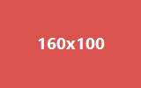
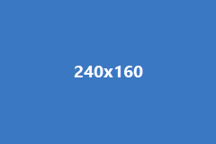
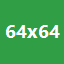

# 图片渲染与交互测试文档

用于回归验证图片解析、渲染与右键菜单。本文件依赖同目录下的 `assets/` 资源：

- `docs/assets/red.png`（160×100）
- `docs/assets/blue.png`（240×160）
- `docs/assets/icon.png`（64×64）

打开本文件时请确认已保存到磁盘（未保存文档没有基准目录，相对路径无法解析）。

## 1. 本地相对路径

## 2. 带标题与空替代文本

## 3. 路径写法

反斜杠分隔（Windows 风格）：

带 `./` 前缀：

使用 `../` 回到上级再进入：

绝对路径（本机不存在时渲染为错误态，可自行改成真实路径）：

## 4. 重复引用同一文件

## 5. 远程 URL

## 6. 引用式图片

![完整引用][full-ref]

![折叠引用][]

![快捷引用]

[full-ref]: ./assets/red.png "完整引用标题"
[折叠引用]: ./assets/blue.png
[快捷引用]: ./assets/icon.png

## 7. 链接包裹的图片

## 8. 列表与引用中的图片

- 列表项一：
- 列表项二：文本 +  + 文本

1. 有序一：
2. 有序二

> 引用中的图片：
>
> 

- [ ] 任务项：
- [x] 已完成任务

## 9. 表格中的图片

| 列一 | 列二 | 列三 |
| --- | --- | --- |
| 文本 |  |  |
|  与文本 | 尾巴 | 结尾 |

## 10. 内嵌 base64（data URI）

PNG（64×64 绿色图标的 base64 载荷）：

内嵌 SVG：

## 11. HTML 图片

行内 HTML：这段文字后面跟一个  图片。

块级 HTML：

## 12. 错误与边界

缺失文件：

不是图片扩展名：

转义的图片语法（应显示为字面文本，不渲染）：

\

混合文本（不是独立图片，应保持为文本）：

前缀文本  后缀文本

## 13. 右键菜单测试清单

在图片上点右键，逐项验证：

1. 打开图片位置
2. 复制图片到
3. 复制图片
4. 缩放图片（子菜单）
5. 复制 / 粘贴为...
6. 段落、插入等通用项仍然可用
