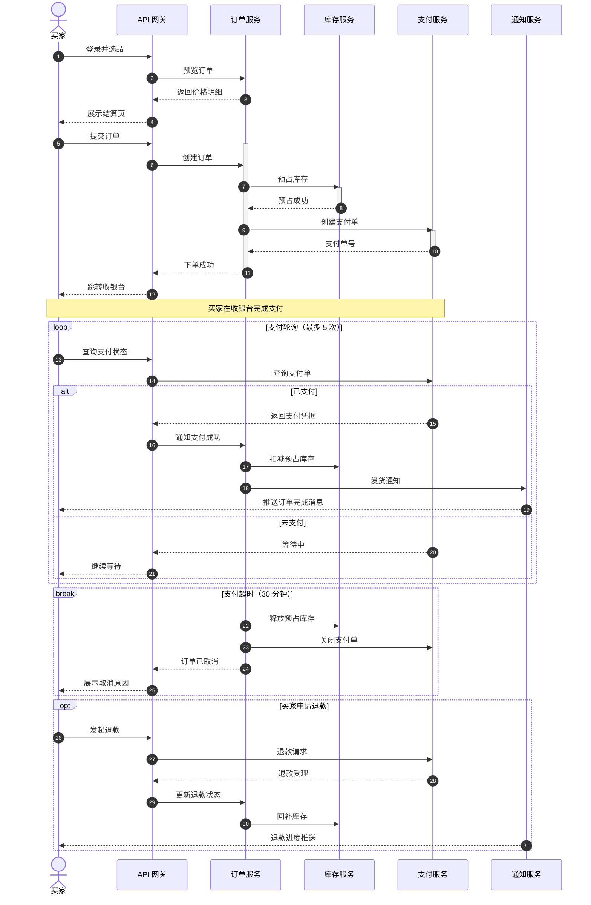
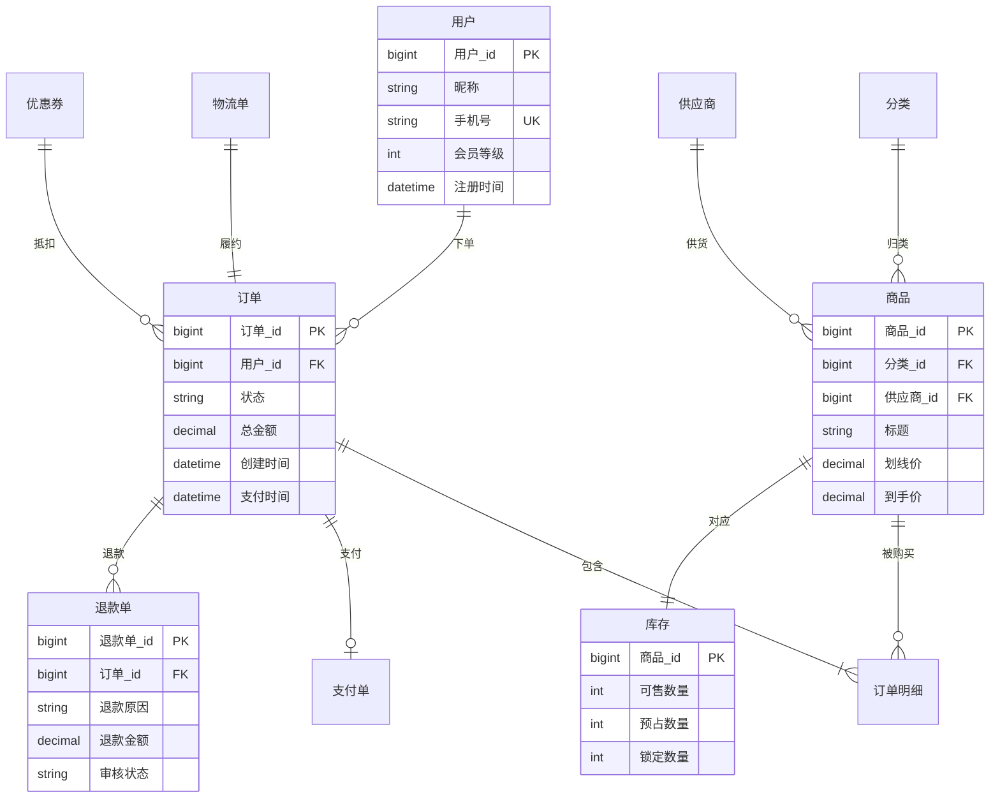
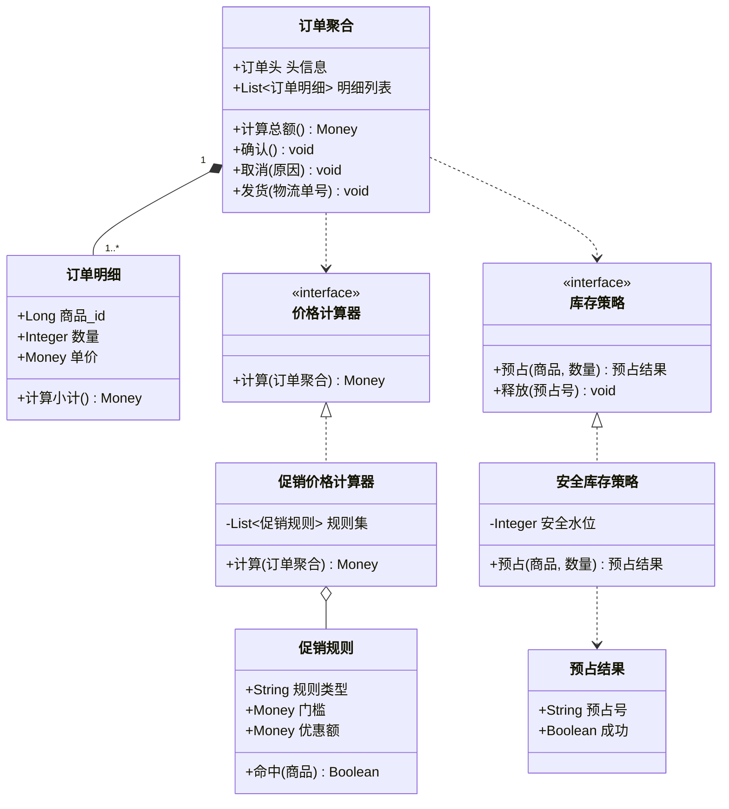
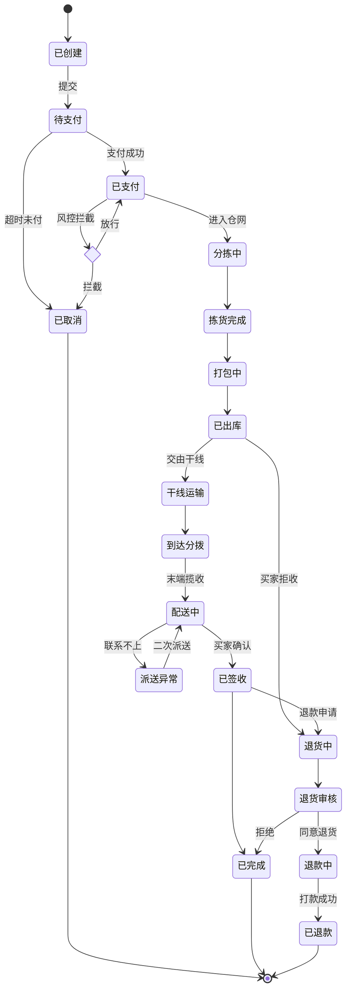
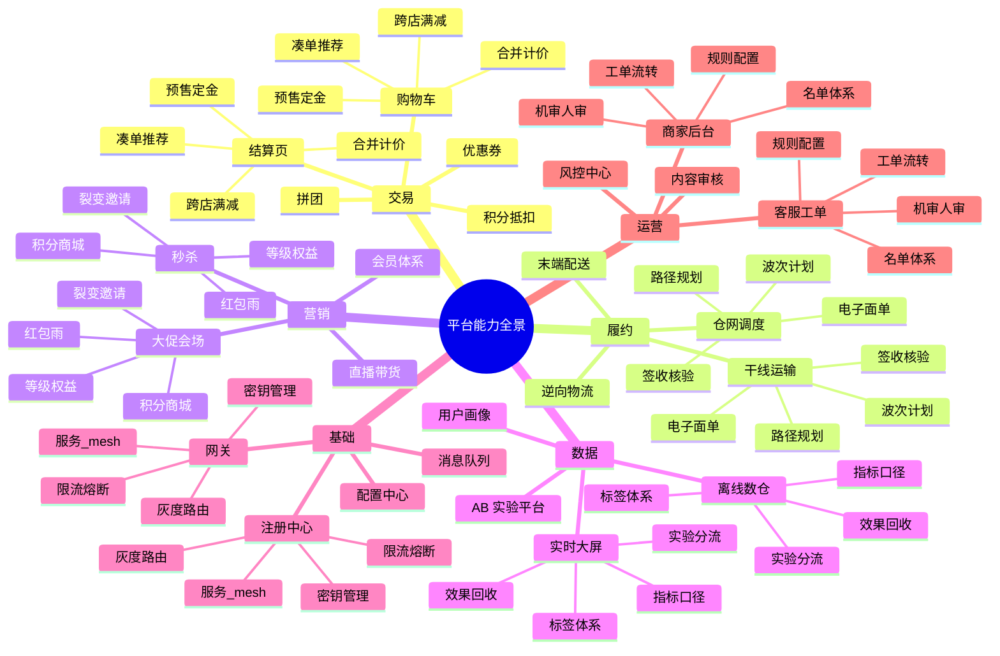
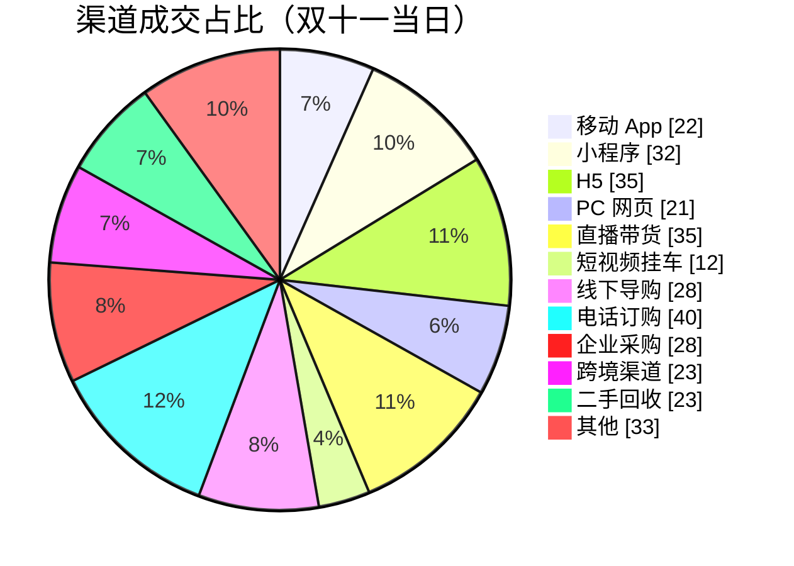
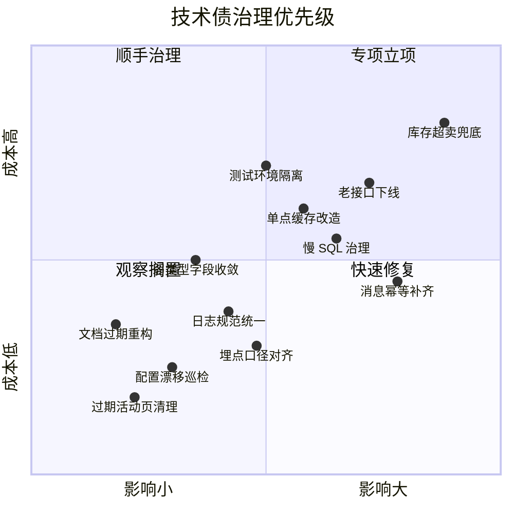
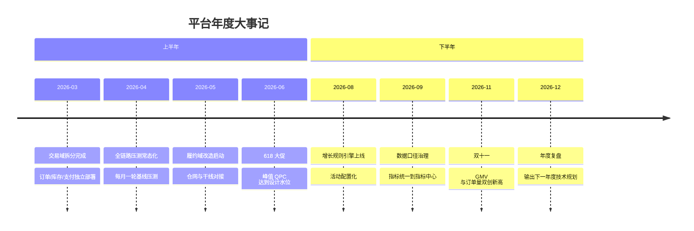
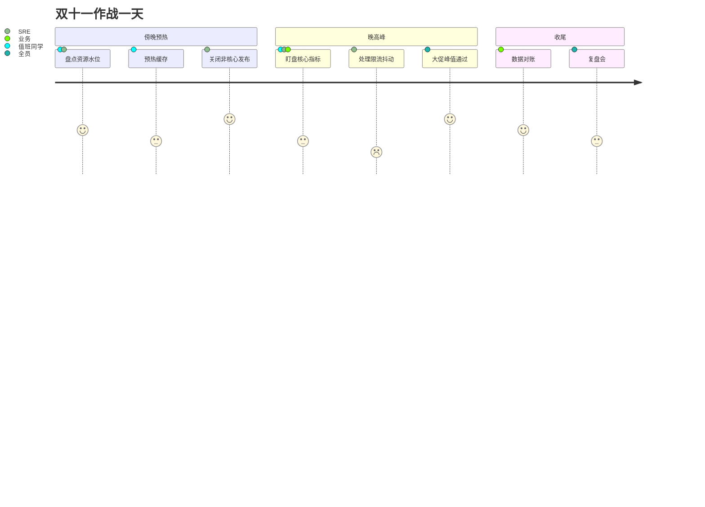

# 大文档样张（性能与渲染回归）
> 本文档模拟真实用户的大体量笔记：13 种 Mermaid 图表，其中多张大尺寸图（数十节点/数十消息/数十任务），穿插长段落、大表格、长列表、代码块、公式、脚注与任务列表。参照 issue #84 的 84KB 文档规模构造，用于验证编辑性能（块运行时缓存、派生数据）与大图的渲染正确性。逐屏目检时重点观察：滚动流畅度、大图首次渲染耗时、长表格/列表的布局、图表聚焦后「源码 + 渲染同屏」的表现。
## 1. 整体架构
电商平台的中台化改造是一项系统性工程，它要求团队在业务高速迭代的同时，把散落在各个单体应用中的领域逻辑沉淀为可复用的能力中心。这件事的难点从来不在技术本身，而在于如何划分边界：哪些能力应该下沉，哪些应该留在业务侧，下沉的粒度多大才不至于让调用方失去灵活性。每一次边界调整都会牵动接口契约、数据模型与组织协作方式，因此需要小步演进、灰度切换，并随时准备回退。
在压测与容量规划阶段，我们通常按照峰值流量的三倍来准备资源水位，并把限流阈值配置在压测通过值的八成左右。这样做的原因是线上流量存在天然波动，大促期间还会叠加营销活动的脉冲式增长；如果阈值贴着压测极限配置，任何一次缓存抖动或慢查询都可能引发连锁超时。历史经验表明，故障往往发生在系统最繁忙的时刻，而此时的恢复窗口最短。
```mermaid
flowchart TB
    请求([客户端请求]) --> 边缘
    subgraph 接入层
        direction LR
        边缘{负载均衡}
        节点1 [接入网关节点1]
        节点2 [接入网关节点2]
        节点3 [接入网关节点3]
        节点4 [接入网关节点4]
        节点5 [接入网关节点5]
        节点6 [接入网关节点6]
    end
    subgraph 业务层
        direction LR
        业务1 [领域服务业务1]
        业务2 [领域服务业务2]
        业务3 [领域服务业务3]
        业务4 [领域服务业务4]
        业务5 [领域服务业务5]
        业务6 [领域服务业务6]
        业务7 [领域服务业务7]
        业务8 [领域服务业务8]
    end
    subgraph 数据层
        direction LR
        数据1 [存储数据1]
        数据2 [存储数据2]
        数据3 [存储数据3]
        数据4 [存储数据4]
        数据5 [存储数据5]
        数据6 [存储数据6]
        数据7 [存储数据7]
        数据8 [存储数据8]
    end
    subgraph 运维层
        direction LR
        运维1 [组件运维1]
        运维2 [组件运维2]
        运维3 [组件运维3]
        运维4 [组件运维4]
        运维5 [组件运维5]
        运维6 [组件运维6]
    end
    节点1 --> 业务1
    节点2 --> 业务2
    节点3 --> 业务3
    节点4 --> 业务4
    节点5 --> 业务1
    节点6 --> 业务2
    边缘 -.-> 运维1
    业务1 --> 业务2 : 事件总线
    业务2 --> 业务3 : 事件总线
    业务3 --> 业务4 : 事件总线
    业务4 --> 业务5 : 事件总线
    业务5 --> 业务6 : 事件总线
    业务6 --> 业务7 : 事件总线
    业务7 --> 业务8 : 事件总线
    业务8 --> 业务1 : 事件总线
    业务1 --> 数据1
    业务2 --> 数据2
    业务3 --> 数据3
    业务4 --> 数据4
    业务5 --> 数据5
    业务6 --> 数据1
    业务7 --> 数据2
    业务8 --> 数据3
    业务2 --> 缓存[(Redis 集群)]
    业务5 --> 主库[(MySQL 主库)]
    业务6 --> 搜索[(Elasticsearch)]
    数据1 -.-> 运维1 : 指标上报
    数据2 -.-> 运维2 : 指标上报
    数据3 -.-> 运维3 : 指标上报
    数据4 -.-> 运维4 : 指标上报
    数据5 -.-> 运维5 : 指标上报
    数据6 -.-> 运维6 : 指标上报
    运维1[监控告警] ==> 运维2[日志检索]
    运维3[链路追踪] --- 运维4[容量看板]
    classDef core fill:#e8f5e9,stroke:#2e7d32
    class 业务1,业务2,业务5 core
```

### 架构约束
电商平台的中台化改造是一项系统性工程，它要求团队在业务高速迭代的同时，把散落在各个单体应用中的领域逻辑沉淀为可复用的能力中心。这件事的难点从来不在技术本身，而在于如何划分边界：哪些能力应该下沉，哪些应该留在业务侧，下沉的粒度多大才不至于让调用方失去灵活性。每一次边界调整都会牵动接口契约、数据模型与组织协作方式，因此需要小步演进、灰度切换，并随时准备回退。
| 约束项 | 说明 | 负责团队 | 检查频率 || --- | --- | --- | --- |
| 约束1 | 描述约束项的完整语义说明文本，包含背景、影响面与处理方式 | 团队2 | 每2天 |
| 约束2 | 描述约束项的完整语义说明文本，包含背景、影响面与处理方式 | 团队3 | 每3天 |
| 约束3 | 描述约束项的完整语义说明文本，包含背景、影响面与处理方式 | 团队4 | 每4天 |
| 约束4 | 描述约束项的完整语义说明文本，包含背景、影响面与处理方式 | 团队5 | 每5天 |
| 约束5 | 描述约束项的完整语义说明文本，包含背景、影响面与处理方式 | 团队1 | 每6天 |
| 约束6 | 描述约束项的完整语义说明文本，包含背景、影响面与处理方式 | 团队2 | 每7天 |
| 约束7 | 描述约束项的完整语义说明文本，包含背景、影响面与处理方式 | 团队3 | 每1天 |
| 约束8 | 描述约束项的完整语义说明文本，包含背景、影响面与处理方式 | 团队4 | 每2天 |
| 约束9 | 描述约束项的完整语义说明文本，包含背景、影响面与处理方式 | 团队5 | 每3天 |
| 约束10 | 描述约束项的完整语义说明文本，包含背景、影响面与处理方式 | 团队1 | 每4天 |
| 约束11 | 描述约束项的完整语义说明文本，包含背景、影响面与处理方式 | 团队2 | 每5天 |
| 约束12 | 描述约束项的完整语义说明文本，包含背景、影响面与处理方式 | 团队3 | 每6天 |
| 约束13 | 描述约束项的完整语义说明文本，包含背景、影响面与处理方式 | 团队4 | 每7天 |
| 约束14 | 描述约束项的完整语义说明文本，包含背景、影响面与处理方式 | 团队5 | 每1天 |
| 约束15 | 描述约束项的完整语义说明文本，包含背景、影响面与处理方式 | 团队1 | 每2天 |
| 约束16 | 描述约束项的完整语义说明文本，包含背景、影响面与处理方式 | 团队2 | 每3天 |
| 约束17 | 描述约束项的完整语义说明文本，包含背景、影响面与处理方式 | 团队3 | 每4天 |
| 约束18 | 描述约束项的完整语义说明文本，包含背景、影响面与处理方式 | 团队4 | 每5天 |
| 约束19 | 描述约束项的完整语义说明文本，包含背景、影响面与处理方式 | 团队5 | 每6天 |
| 约束20 | 描述约束项的完整语义说明文本，包含背景、影响面与处理方式 | 团队1 | 每7天 |
| 约束21 | 描述约束项的完整语义说明文本，包含背景、影响面与处理方式 | 团队2 | 每1天 |
| 约束22 | 描述约束项的完整语义说明文本，包含背景、影响面与处理方式 | 团队3 | 每2天 |
| 约束23 | 描述约束项的完整语义说明文本，包含背景、影响面与处理方式 | 团队4 | 每3天 |
| 约束24 | 描述约束项的完整语义说明文本，包含背景、影响面与处理方式 | 团队5 | 每4天 |
| 约束25 | 描述约束项的完整语义说明文本，包含背景、影响面与处理方式 | 团队1 | 每5天 |
| 约束26 | 描述约束项的完整语义说明文本，包含背景、影响面与处理方式 | 团队2 | 每6天 |
| 约束27 | 描述约束项的完整语义说明文本，包含背景、影响面与处理方式 | 团队3 | 每7天 |
| 约束28 | 描述约束项的完整语义说明文本，包含背景、影响面与处理方式 | 团队4 | 每1天 |
| 约束29 | 描述约束项的完整语义说明文本，包含背景、影响面与处理方式 | 团队5 | 每2天 |
| 约束30 | 描述约束项的完整语义说明文本，包含背景、影响面与处理方式 | 团队1 | 每3天 |
| 约束31 | 描述约束项的完整语义说明文本，包含背景、影响面与处理方式 | 团队2 | 每4天 |
| 约束32 | 描述约束项的完整语义说明文本，包含背景、影响面与处理方式 | 团队3 | 每5天 |
| 约束33 | 描述约束项的完整语义说明文本，包含背景、影响面与处理方式 | 团队4 | 每6天 |
| 约束34 | 描述约束项的完整语义说明文本，包含背景、影响面与处理方式 | 团队5 | 每7天 |
| 约束35 | 描述约束项的完整语义说明文本，包含背景、影响面与处理方式 | 团队1 | 每1天 |
| 约束36 | 描述约束项的完整语义说明文本，包含背景、影响面与处理方式 | 团队2 | 每2天 |
| 约束37 | 描述约束项的完整语义说明文本，包含背景、影响面与处理方式 | 团队3 | 每3天 |
| 约束38 | 描述约束项的完整语义说明文本，包含背景、影响面与处理方式 | 团队4 | 每4天 |
| 约束39 | 描述约束项的完整语义说明文本，包含背景、影响面与处理方式 | 团队5 | 每5天 |
| 约束40 | 描述约束项的完整语义说明文本，包含背景、影响面与处理方式 | 团队1 | 每6天 |

## 2. 下单链路时序
监控体系的建设应当遵循「先可观测、再可诊断、后可预测」的路径。第一步是把日志、指标、链路三类数据收集齐全，并保证告警的去重与收敛；第二步是基于调用链路定位瓶颈，建立常见故障模式的手册；第三步才是利用历史数据进行异常检测与容量预测。跳过前两步直接谈智能化，得到的往往是无人信任的告警风暴。
文档与代码同样需要评审。接口文档的每一个字段的语义、取值范围、错误码都应该有明确的定义，并在变更时同步更新版本号。历史上多次出现的线上事故，追根溯源都是「实现与文档不一致」：调用方按文档传参，服务端却悄悄改了校验规则。把文档检查纳入流水线，让不一致在评审阶段暴露，是成本最低的防线。


### 链路说明
在压测与容量规划阶段，我们通常按照峰值流量的三倍来准备资源水位，并把限流阈值配置在压测通过值的八成左右。这样做的原因是线上流量存在天然波动，大促期间还会叠加营销活动的脉冲式增长；如果阈值贴着压测极限配置，任何一次缓存抖动或慢查询都可能引发连锁超时。历史经验表明，故障往往发生在系统最繁忙的时刻，而此时的恢复窗口最短。
- 登录与鉴权：网关统一校验令牌，服务间调用走内部证书。- 库存预占：采用“预占 + 超时释放”两阶段模型，超时由定时任务兜底。- 支付回调：以支付服务为唯一可信源，订单侧只消费回调事件。
- 要点1：链路中需要重点保障的第 1 个稳定性措施与对应的验证手段说明。
- 要点2：链路中需要重点保障的第 2 个稳定性措施与对应的验证手段说明。
- 要点3：链路中需要重点保障的第 3 个稳定性措施与对应的验证手段说明。
- 要点4：链路中需要重点保障的第 4 个稳定性措施与对应的验证手段说明。
- 要点5：链路中需要重点保障的第 5 个稳定性措施与对应的验证手段说明。
- 要点6：链路中需要重点保障的第 6 个稳定性措施与对应的验证手段说明。
- 要点7：链路中需要重点保障的第 7 个稳定性措施与对应的验证手段说明。
- 要点8：链路中需要重点保障的第 8 个稳定性措施与对应的验证手段说明。
- 要点9：链路中需要重点保障的第 9 个稳定性措施与对应的验证手段说明。
- 要点10：链路中需要重点保障的第 10 个稳定性措施与对应的验证手段说明。
- 要点11：链路中需要重点保障的第 11 个稳定性措施与对应的验证手段说明。
- 要点12：链路中需要重点保障的第 12 个稳定性措施与对应的验证手段说明。
- 要点13：链路中需要重点保障的第 13 个稳定性措施与对应的验证手段说明。
- 要点14：链路中需要重点保障的第 14 个稳定性措施与对应的验证手段说明。
- 要点15：链路中需要重点保障的第 15 个稳定性措施与对应的验证手段说明。
- 要点16：链路中需要重点保障的第 16 个稳定性措施与对应的验证手段说明。
- 要点17：链路中需要重点保障的第 17 个稳定性措施与对应的验证手段说明。
- 要点18：链路中需要重点保障的第 18 个稳定性措施与对应的验证手段说明。
- 要点19：链路中需要重点保障的第 19 个稳定性措施与对应的验证手段说明。
- 要点20：链路中需要重点保障的第 20 个稳定性措施与对应的验证手段说明。
- 要点21：链路中需要重点保障的第 21 个稳定性措施与对应的验证手段说明。
- 要点22：链路中需要重点保障的第 22 个稳定性措施与对应的验证手段说明。
- 要点23：链路中需要重点保障的第 23 个稳定性措施与对应的验证手段说明。
- 要点24：链路中需要重点保障的第 24 个稳定性措施与对应的验证手段说明。
- 要点25：链路中需要重点保障的第 25 个稳定性措施与对应的验证手段说明。
- 要点26：链路中需要重点保障的第 26 个稳定性措施与对应的验证手段说明。
- 要点27：链路中需要重点保障的第 27 个稳定性措施与对应的验证手段说明。
- 要点28：链路中需要重点保障的第 28 个稳定性措施与对应的验证手段说明。
- 要点29：链路中需要重点保障的第 29 个稳定性措施与对应的验证手段说明。
- 要点30：链路中需要重点保障的第 30 个稳定性措施与对应的验证手段说明。
- 要点31：链路中需要重点保障的第 31 个稳定性措施与对应的验证手段说明。
- 要点32：链路中需要重点保障的第 32 个稳定性措施与对应的验证手段说明。
- 要点33：链路中需要重点保障的第 33 个稳定性措施与对应的验证手段说明。
- 要点34：链路中需要重点保障的第 34 个稳定性措施与对应的验证手段说明。
- 要点35：链路中需要重点保障的第 35 个稳定性措施与对应的验证手段说明。
- 要点36：链路中需要重点保障的第 36 个稳定性措施与对应的验证手段说明。
- 要点37：链路中需要重点保障的第 37 个稳定性措施与对应的验证手段说明。
- 要点38：链路中需要重点保障的第 38 个稳定性措施与对应的验证手段说明。
- 要点39：链路中需要重点保障的第 39 个稳定性措施与对应的验证手段说明。
- 要点40：链路中需要重点保障的第 40 个稳定性措施与对应的验证手段说明。
- 要点41：链路中需要重点保障的第 41 个稳定性措施与对应的验证手段说明。
- 要点42：链路中需要重点保障的第 42 个稳定性措施与对应的验证手段说明。
- 要点43：链路中需要重点保障的第 43 个稳定性措施与对应的验证手段说明。
- 要点44：链路中需要重点保障的第 44 个稳定性措施与对应的验证手段说明。
- 要点45：链路中需要重点保障的第 45 个稳定性措施与对应的验证手段说明。
- 要点46：链路中需要重点保障的第 46 个稳定性措施与对应的验证手段说明。
- 要点47：链路中需要重点保障的第 47 个稳定性措施与对应的验证手段说明。
- 要点48：链路中需要重点保障的第 48 个稳定性措施与对应的验证手段说明。
- 要点49：链路中需要重点保障的第 49 个稳定性措施与对应的验证手段说明。
- 要点50：链路中需要重点保障的第 50 个稳定性措施与对应的验证手段说明。
- 要点51：链路中需要重点保障的第 51 个稳定性措施与对应的验证手段说明。
- 要点52：链路中需要重点保障的第 52 个稳定性措施与对应的验证手段说明。
- 要点53：链路中需要重点保障的第 53 个稳定性措施与对应的验证手段说明。
- 要点54：链路中需要重点保障的第 54 个稳定性措施与对应的验证手段说明。
- 要点55：链路中需要重点保障的第 55 个稳定性措施与对应的验证手段说明。
- 要点56：链路中需要重点保障的第 56 个稳定性措施与对应的验证手段说明。
- 要点57：链路中需要重点保障的第 57 个稳定性措施与对应的验证手段说明。
- 要点58：链路中需要重点保障的第 58 个稳定性措施与对应的验证手段说明。
- 要点59：链路中需要重点保障的第 59 个稳定性措施与对应的验证手段说明。
- 要点60：链路中需要重点保障的第 60 个稳定性措施与对应的验证手段说明。
- 要点61：链路中需要重点保障的第 61 个稳定性措施与对应的验证手段说明。
- 要点62：链路中需要重点保障的第 62 个稳定性措施与对应的验证手段说明。
- 要点63：链路中需要重点保障的第 63 个稳定性措施与对应的验证手段说明。
- 要点64：链路中需要重点保障的第 64 个稳定性措施与对应的验证手段说明。
- 要点65：链路中需要重点保障的第 65 个稳定性措施与对应的验证手段说明。
- 要点66：链路中需要重点保障的第 66 个稳定性措施与对应的验证手段说明。
- 要点67：链路中需要重点保障的第 67 个稳定性措施与对应的验证手段说明。
- 要点68：链路中需要重点保障的第 68 个稳定性措施与对应的验证手段说明。
- 要点69：链路中需要重点保障的第 69 个稳定性措施与对应的验证手段说明。
- 要点70：链路中需要重点保障的第 70 个稳定性措施与对应的验证手段说明。
- 要点71：链路中需要重点保障的第 71 个稳定性措施与对应的验证手段说明。
- 要点72：链路中需要重点保障的第 72 个稳定性措施与对应的验证手段说明。
- 要点73：链路中需要重点保障的第 73 个稳定性措施与对应的验证手段说明。
- 要点74：链路中需要重点保障的第 74 个稳定性措施与对应的验证手段说明。
- 要点75：链路中需要重点保障的第 75 个稳定性措施与对应的验证手段说明。
- 要点76：链路中需要重点保障的第 76 个稳定性措施与对应的验证手段说明。
- 要点77：链路中需要重点保障的第 77 个稳定性措施与对应的验证手段说明。
- 要点78：链路中需要重点保障的第 78 个稳定性措施与对应的验证手段说明。
- 要点79：链路中需要重点保障的第 79 个稳定性措施与对应的验证手段说明。
- 要点80：链路中需要重点保障的第 80 个稳定性措施与对应的验证手段说明。
- 要点81：链路中需要重点保障的第 81 个稳定性措施与对应的验证手段说明。
- 要点82：链路中需要重点保障的第 82 个稳定性措施与对应的验证手段说明。
- 要点83：链路中需要重点保障的第 83 个稳定性措施与对应的验证手段说明。
- 要点84：链路中需要重点保障的第 84 个稳定性措施与对应的验证手段说明。
- 要点85：链路中需要重点保障的第 85 个稳定性措施与对应的验证手段说明。
- 要点86：链路中需要重点保障的第 86 个稳定性措施与对应的验证手段说明。
- 要点87：链路中需要重点保障的第 87 个稳定性措施与对应的验证手段说明。
- 要点88：链路中需要重点保障的第 88 个稳定性措施与对应的验证手段说明。
- 要点89：链路中需要重点保障的第 89 个稳定性措施与对应的验证手段说明。
- 要点90：链路中需要重点保障的第 90 个稳定性措施与对应的验证手段说明。
- 要点91：链路中需要重点保障的第 91 个稳定性措施与对应的验证手段说明。
- 要点92：链路中需要重点保障的第 92 个稳定性措施与对应的验证手段说明。
- 要点93：链路中需要重点保障的第 93 个稳定性措施与对应的验证手段说明。
- 要点94：链路中需要重点保障的第 94 个稳定性措施与对应的验证手段说明。
- 要点95：链路中需要重点保障的第 95 个稳定性措施与对应的验证手段说明。
- 要点96：链路中需要重点保障的第 96 个稳定性措施与对应的验证手段说明。
- 要点97：链路中需要重点保障的第 97 个稳定性措施与对应的验证手段说明。
- 要点98：链路中需要重点保障的第 98 个稳定性措施与对应的验证手段说明。
- 要点99：链路中需要重点保障的第 99 个稳定性措施与对应的验证手段说明。
- 要点100：链路中需要重点保障的第 100 个稳定性措施与对应的验证手段说明。

## 3. 数据模型
库存服务的最终一致性方案采用了本地消息表加对账补偿的组合：先在事务内落库业务数据与消息，再由异步任务投递到下游；对账任务每五分钟核对一次两边的状态差异，发现不一致便触发补偿或告警。这套机制的代价是需要维护消息表的生命周期与幂等消费，收益则是把分布式事务的复杂度限制在了单个服务内部。
电商平台的中台化改造是一项系统性工程，它要求团队在业务高速迭代的同时，把散落在各个单体应用中的领域逻辑沉淀为可复用的能力中心。这件事的难点从来不在技术本身，而在于如何划分边界：哪些能力应该下沉，哪些应该留在业务侧，下沉的粒度多大才不至于让调用方失去灵活性。每一次边界调整都会牵动接口契约、数据模型与组织协作方式，因此需要小步演进、灰度切换，并随时准备回退。


### 字段补充说明
| 实体 | 字段 | 语义 || --- | --- | --- |
| 订单 | 状态 | 待付款/已付款/已发货/已完成/已取消/退款中 |
| 库存 | 预占数量 | 下单未支付时锁定，支付后转扣减 |
| 退款单 | 审核状态 | 待审核/已同意/已拒绝/已打款 |
| 商品 | 到手价 | 活动价与会员价择优后的成交价 |
| 用户 | 会员等级 | 按近 365 天消费金额分档 |
| 实体1 | 字段1 | 补充说明文本1，用于撑起表格体积与真实阅读感 |
| 实体2 | 字段2 | 补充说明文本2，用于撑起表格体积与真实阅读感 |
| 实体3 | 字段3 | 补充说明文本3，用于撑起表格体积与真实阅读感 |
| 实体4 | 字段4 | 补充说明文本4，用于撑起表格体积与真实阅读感 |
| 实体5 | 字段5 | 补充说明文本5，用于撑起表格体积与真实阅读感 |
| 实体6 | 字段6 | 补充说明文本6，用于撑起表格体积与真实阅读感 |
| 实体7 | 字段7 | 补充说明文本7，用于撑起表格体积与真实阅读感 |
| 实体8 | 字段8 | 补充说明文本8，用于撑起表格体积与真实阅读感 |
| 实体9 | 字段9 | 补充说明文本9，用于撑起表格体积与真实阅读感 |
| 实体10 | 字段10 | 补充说明文本10，用于撑起表格体积与真实阅读感 |
| 实体11 | 字段11 | 补充说明文本11，用于撑起表格体积与真实阅读感 |
| 实体12 | 字段12 | 补充说明文本12，用于撑起表格体积与真实阅读感 |
| 实体13 | 字段13 | 补充说明文本13，用于撑起表格体积与真实阅读感 |
| 实体14 | 字段14 | 补充说明文本14，用于撑起表格体积与真实阅读感 |
| 实体15 | 字段15 | 补充说明文本15，用于撑起表格体积与真实阅读感 |

## 4. 领域类图
在压测与容量规划阶段，我们通常按照峰值流量的三倍来准备资源水位，并把限流阈值配置在压测通过值的八成左右。这样做的原因是线上流量存在天然波动，大促期间还会叠加营销活动的脉冲式增长；如果阈值贴着压测极限配置，任何一次缓存抖动或慢查询都可能引发连锁超时。历史经验表明，故障往往发生在系统最繁忙的时刻，而此时的恢复窗口最短。
监控体系的建设应当遵循「先可观测、再可诊断、后可预测」的路径。第一步是把日志、指标、链路三类数据收集齐全，并保证告警的去重与收敛；第二步是基于调用链路定位瓶颈，建立常见故障模式的手册；第三步才是利用历史数据进行异常检测与容量预测。跳过前两步直接谈智能化，得到的往往是无人信任的告警风暴。


### 设计取舍
监控体系的建设应当遵循「先可观测、再可诊断、后可预测」的路径。第一步是把日志、指标、链路三类数据收集齐全，并保证告警的去重与收敛；第二步是基于调用链路定位瓶颈，建立常见故障模式的手册；第三步才是利用历史数据进行异常检测与容量预测。跳过前两步直接谈智能化，得到的往往是无人信任的告警风暴。
| 决策点 | 方案 A | 方案 B | 结论 || --- | --- | --- | --- |
| 决策1 | 描述方案 A 的语义 | 描述方案 B 的语义 | 采用A |
| 决策2 | 描述方案 A 的语义 | 描述方案 B 的语义 | 采用B |
| 决策3 | 描述方案 A 的语义 | 描述方案 B 的语义 | 采用A |
| 决策4 | 描述方案 A 的语义 | 描述方案 B 的语义 | 采用B |
| 决策5 | 描述方案 A 的语义 | 描述方案 B 的语义 | 采用A |
| 决策6 | 描述方案 A 的语义 | 描述方案 B 的语义 | 采用B |
| 决策7 | 描述方案 A 的语义 | 描述方案 B 的语义 | 采用A |
| 决策8 | 描述方案 A 的语义 | 描述方案 B 的语义 | 采用B |
| 决策9 | 描述方案 A 的语义 | 描述方案 B 的语义 | 采用A |
| 决策10 | 描述方案 A 的语义 | 描述方案 B 的语义 | 采用B |
| 决策11 | 描述方案 A 的语义 | 描述方案 B 的语义 | 采用A |
| 决策12 | 描述方案 A 的语义 | 描述方案 B 的语义 | 采用B |

## 5. 订单状态机
文档与代码同样需要评审。接口文档的每一个字段的语义、取值范围、错误码都应该有明确的定义，并在变更时同步更新版本号。历史上多次出现的线上事故，追根溯源都是「实现与文档不一致」：调用方按文档传参，服务端却悄悄改了校验规则。把文档检查纳入流水线，让不一致在评审阶段暴露，是成本最低的防线。
库存服务的最终一致性方案采用了本地消息表加对账补偿的组合：先在事务内落库业务数据与消息，再由异步任务投递到下游；对账任务每五分钟核对一次两边的状态差异，发现不一致便触发补偿或告警。这套机制的代价是需要维护消息表的生命周期与幂等消费，收益则是把分布式事务的复杂度限制在了单个服务内部。


### 状态迁移表
| 当前状态 | 事件 | 目标状态 | 触发方 || --- | --- | --- | --- |
| 状态2 | 事件1 | 状态3 | 系统2 |
| 状态3 | 事件2 | 状态4 | 系统3 |
| 状态4 | 事件3 | 状态5 | 系统1 |
| 状态5 | 事件4 | 状态6 | 系统2 |
| 状态6 | 事件5 | 状态7 | 系统3 |
| 状态7 | 事件6 | 状态8 | 系统1 |
| 状态8 | 事件7 | 状态9 | 系统2 |
| 状态1 | 事件8 | 状态2 | 系统3 |
| 状态2 | 事件9 | 状态3 | 系统1 |
| 状态3 | 事件10 | 状态4 | 系统2 |
| 状态4 | 事件11 | 状态5 | 系统3 |
| 状态5 | 事件12 | 状态6 | 系统1 |
| 状态6 | 事件13 | 状态7 | 系统2 |
| 状态7 | 事件14 | 状态8 | 系统3 |
| 状态8 | 事件15 | 状态9 | 系统1 |
| 状态1 | 事件16 | 状态2 | 系统2 |
| 状态2 | 事件17 | 状态3 | 系统3 |
| 状态3 | 事件18 | 状态4 | 系统1 |
| 状态4 | 事件19 | 状态5 | 系统2 |
| 状态5 | 事件20 | 状态6 | 系统3 |
| 状态6 | 事件21 | 状态7 | 系统1 |
| 状态7 | 事件22 | 状态8 | 系统2 |

## 6. 发布排期
电商平台的中台化改造是一项系统性工程，它要求团队在业务高速迭代的同时，把散落在各个单体应用中的领域逻辑沉淀为可复用的能力中心。这件事的难点从来不在技术本身，而在于如何划分边界：哪些能力应该下沉，哪些应该留在业务侧，下沉的粒度多大才不至于让调用方失去灵活性。每一次边界调整都会牵动接口契约、数据模型与组织协作方式，因此需要小步演进、灰度切换，并随时准备回退。
在压测与容量规划阶段，我们通常按照峰值流量的三倍来准备资源水位，并把限流阈值配置在压测通过值的八成左右。这样做的原因是线上流量存在天然波动，大促期间还会叠加营销活动的脉冲式增长；如果阈值贴着压测极限配置，任何一次缓存抖动或慢查询都可能引发连锁超时。历史经验表明，故障往往发生在系统最繁忙的时刻，而此时的恢复窗口最短。
```mermaid
gantt
    title 平台季度发布计划
    dateFormat YYYY-MM-DD
    axisFormat %m-%d
    section 基础能力
        配置中心升级 :done, s0t0, 2026-11-02, 5d
        注册中心扩容 s0t1, after s0t0, 4d
        链路埋点改造 s0t2, after s0t1, 5d
        网关灰度策略 s0t3, after s0t2, 6d
        证书轮换自动化 s0t4, after s0t3, 3d
    section 交易域
        订单服务拆分 s1t0, after s1t-1, 3d
        库存预占重构 s1t1, after s1t0, 4d
        价格中心接入 s1t2, after s1t1, 5d
        优惠券合并结算 s1t3, after s1t2, 6d
        退款链路优化 s1t4, after s1t3, 3d
    section 履约域
        仓网路由调整 s2t0, after s2t-1, 3d
        干线对接改造 s2t1, after s2t0, 4d
        末端派单算法 s2t2, after s2t1, 5d
        逆向物流接入 s2t3, after s2t2, 6d
    section 增长域
        活动规则引擎 s3t0, after s3t-1, 3d
        秒杀库存预热 :crit, s3t1, after s3t0, 4d
        消息触达优化 s3t2, after s3t1, 5d
        埋点数据治理 s3t3, after s3t2, 6d
    section 稳定性
        全链路压测 :active, s4t0, after s4t-1, 3d
        预案演练 s4t1, after s4t0, 4d
        监控补齐 s4t2, after s4t1, 5d
        容量复核 s4t3, after s4t2, 6d
    section 发布
        灰度验证 s5t0, after s5t-1, 3d
        全量发布 :milestone, s5t1, 2026-12-24, 0d
        发布复盘 :crit, s5t2, after s5t1, 3d
```

### 排期风险
1. 订单服务拆分与库存预占重构并行，接口冻结点必须前置。2. 全链路压测依赖前四个域全部提测完成。3. 全量发布窗口与行业大促日错开一周。
    . 补充风险条目1：说明触发条件、影响范围与应对预案。
    . 补充风险条目2：说明触发条件、影响范围与应对预案。
    . 补充风险条目3：说明触发条件、影响范围与应对预案。
    . 补充风险条目4：说明触发条件、影响范围与应对预案。
    . 补充风险条目5：说明触发条件、影响范围与应对预案。
    . 补充风险条目6：说明触发条件、影响范围与应对预案。
    . 补充风险条目7：说明触发条件、影响范围与应对预案。
    . 补充风险条目8：说明触发条件、影响范围与应对预案。
    . 补充风险条目9：说明触发条件、影响范围与应对预案。
    . 补充风险条目10：说明触发条件、影响范围与应对预案。
    . 补充风险条目11：说明触发条件、影响范围与应对预案。
    . 补充风险条目12：说明触发条件、影响范围与应对预案。
    . 补充风险条目13：说明触发条件、影响范围与应对预案。
    . 补充风险条目14：说明触发条件、影响范围与应对预案。
    . 补充风险条目15：说明触发条件、影响范围与应对预案。
    . 补充风险条目16：说明触发条件、影响范围与应对预案。
    . 补充风险条目17：说明触发条件、影响范围与应对预案。
    . 补充风险条目18：说明触发条件、影响范围与应对预案。
    . 补充风险条目19：说明触发条件、影响范围与应对预案。
    . 补充风险条目20：说明触发条件、影响范围与应对预案。
    . 补充风险条目21：说明触发条件、影响范围与应对预案。
    . 补充风险条目22：说明触发条件、影响范围与应对预案。
    . 补充风险条目23：说明触发条件、影响范围与应对预案。
    . 补充风险条目24：说明触发条件、影响范围与应对预案。
    . 补充风险条目25：说明触发条件、影响范围与应对预案。
    . 补充风险条目26：说明触发条件、影响范围与应对预案。
    . 补充风险条目27：说明触发条件、影响范围与应对预案。
    . 补充风险条目28：说明触发条件、影响范围与应对预案。
    . 补充风险条目29：说明触发条件、影响范围与应对预案。
    . 补充风险条目30：说明触发条件、影响范围与应对预案。
    . 补充风险条目31：说明触发条件、影响范围与应对预案。
    . 补充风险条目32：说明触发条件、影响范围与应对预案。
    . 补充风险条目33：说明触发条件、影响范围与应对预案。
    . 补充风险条目34：说明触发条件、影响范围与应对预案。
    . 补充风险条目35：说明触发条件、影响范围与应对预案。
    . 补充风险条目36：说明触发条件、影响范围与应对预案。
    . 补充风险条目37：说明触发条件、影响范围与应对预案。
    . 补充风险条目38：说明触发条件、影响范围与应对预案。
    . 补充风险条目39：说明触发条件、影响范围与应对预案。
    . 补充风险条目40：说明触发条件、影响范围与应对预案。

## 7. 功能全景脑图
监控体系的建设应当遵循「先可观测、再可诊断、后可预测」的路径。第一步是把日志、指标、链路三类数据收集齐全，并保证告警的去重与收敛；第二步是基于调用链路定位瓶颈，建立常见故障模式的手册；第三步才是利用历史数据进行异常检测与容量预测。跳过前两步直接谈智能化，得到的往往是无人信任的告警风暴。
文档与代码同样需要评审。接口文档的每一个字段的语义、取值范围、错误码都应该有明确的定义，并在变更时同步更新版本号。历史上多次出现的线上事故，追根溯源都是「实现与文档不一致」：调用方按文档传参，服务端却悄悄改了校验规则。把文档检查纳入流水线，让不一致在评审阶段暴露，是成本最低的防线。


### 能力清单
- 能力点1：功能描述、当前状态（已上线/灰度中/规划中）与负责团队。
- 能力点2：功能描述、当前状态（已上线/灰度中/规划中）与负责团队。
- 能力点3：功能描述、当前状态（已上线/灰度中/规划中）与负责团队。
- 能力点4：功能描述、当前状态（已上线/灰度中/规划中）与负责团队。
- 能力点5：功能描述、当前状态（已上线/灰度中/规划中）与负责团队。
- 能力点6：功能描述、当前状态（已上线/灰度中/规划中）与负责团队。
- 能力点7：功能描述、当前状态（已上线/灰度中/规划中）与负责团队。
- 能力点8：功能描述、当前状态（已上线/灰度中/规划中）与负责团队。
- 能力点9：功能描述、当前状态（已上线/灰度中/规划中）与负责团队。
- 能力点10：功能描述、当前状态（已上线/灰度中/规划中）与负责团队。
- 能力点11：功能描述、当前状态（已上线/灰度中/规划中）与负责团队。
- 能力点12：功能描述、当前状态（已上线/灰度中/规划中）与负责团队。
- 能力点13：功能描述、当前状态（已上线/灰度中/规划中）与负责团队。
- 能力点14：功能描述、当前状态（已上线/灰度中/规划中）与负责团队。
- 能力点15：功能描述、当前状态（已上线/灰度中/规划中）与负责团队。
- 能力点16：功能描述、当前状态（已上线/灰度中/规划中）与负责团队。
- 能力点17：功能描述、当前状态（已上线/灰度中/规划中）与负责团队。
- 能力点18：功能描述、当前状态（已上线/灰度中/规划中）与负责团队。
- 能力点19：功能描述、当前状态（已上线/灰度中/规划中）与负责团队。
- 能力点20：功能描述、当前状态（已上线/灰度中/规划中）与负责团队。
- 能力点21：功能描述、当前状态（已上线/灰度中/规划中）与负责团队。
- 能力点22：功能描述、当前状态（已上线/灰度中/规划中）与负责团队。
- 能力点23：功能描述、当前状态（已上线/灰度中/规划中）与负责团队。
- 能力点24：功能描述、当前状态（已上线/灰度中/规划中）与负责团队。
- 能力点25：功能描述、当前状态（已上线/灰度中/规划中）与负责团队。
- 能力点26：功能描述、当前状态（已上线/灰度中/规划中）与负责团队。
- 能力点27：功能描述、当前状态（已上线/灰度中/规划中）与负责团队。
- 能力点28：功能描述、当前状态（已上线/灰度中/规划中）与负责团队。
- 能力点29：功能描述、当前状态（已上线/灰度中/规划中）与负责团队。
- 能力点30：功能描述、当前状态（已上线/灰度中/规划中）与负责团队。
- 能力点31：功能描述、当前状态（已上线/灰度中/规划中）与负责团队。
- 能力点32：功能描述、当前状态（已上线/灰度中/规划中）与负责团队。
- 能力点33：功能描述、当前状态（已上线/灰度中/规划中）与负责团队。
- 能力点34：功能描述、当前状态（已上线/灰度中/规划中）与负责团队。
- 能力点35：功能描述、当前状态（已上线/灰度中/规划中）与负责团队。
- 能力点36：功能描述、当前状态（已上线/灰度中/规划中）与负责团队。
- 能力点37：功能描述、当前状态（已上线/灰度中/规划中）与负责团队。
- 能力点38：功能描述、当前状态（已上线/灰度中/规划中）与负责团队。
- 能力点39：功能描述、当前状态（已上线/灰度中/规划中）与负责团队。
- 能力点40：功能描述、当前状态（已上线/灰度中/规划中）与负责团队。
- 能力点41：功能描述、当前状态（已上线/灰度中/规划中）与负责团队。
- 能力点42：功能描述、当前状态（已上线/灰度中/规划中）与负责团队。
- 能力点43：功能描述、当前状态（已上线/灰度中/规划中）与负责团队。
- 能力点44：功能描述、当前状态（已上线/灰度中/规划中）与负责团队。
- 能力点45：功能描述、当前状态（已上线/灰度中/规划中）与负责团队。
- 能力点46：功能描述、当前状态（已上线/灰度中/规划中）与负责团队。
- 能力点47：功能描述、当前状态（已上线/灰度中/规划中）与负责团队。
- 能力点48：功能描述、当前状态（已上线/灰度中/规划中）与负责团队。
- 能力点49：功能描述、当前状态（已上线/灰度中/规划中）与负责团队。
- 能力点50：功能描述、当前状态（已上线/灰度中/规划中）与负责团队。
- 能力点51：功能描述、当前状态（已上线/灰度中/规划中）与负责团队。
- 能力点52：功能描述、当前状态（已上线/灰度中/规划中）与负责团队。
- 能力点53：功能描述、当前状态（已上线/灰度中/规划中）与负责团队。
- 能力点54：功能描述、当前状态（已上线/灰度中/规划中）与负责团队。
- 能力点55：功能描述、当前状态（已上线/灰度中/规划中）与负责团队。
- 能力点56：功能描述、当前状态（已上线/灰度中/规划中）与负责团队。
- 能力点57：功能描述、当前状态（已上线/灰度中/规划中）与负责团队。
- 能力点58：功能描述、当前状态（已上线/灰度中/规划中）与负责团队。
- 能力点59：功能描述、当前状态（已上线/灰度中/规划中）与负责团队。
- 能力点60：功能描述、当前状态（已上线/灰度中/规划中）与负责团队。
- 能力点61：功能描述、当前状态（已上线/灰度中/规划中）与负责团队。
- 能力点62：功能描述、当前状态（已上线/灰度中/规划中）与负责团队。
- 能力点63：功能描述、当前状态（已上线/灰度中/规划中）与负责团队。
- 能力点64：功能描述、当前状态（已上线/灰度中/规划中）与负责团队。
- 能力点65：功能描述、当前状态（已上线/灰度中/规划中）与负责团队。
- 能力点66：功能描述、当前状态（已上线/灰度中/规划中）与负责团队。
- 能力点67：功能描述、当前状态（已上线/灰度中/规划中）与负责团队。
- 能力点68：功能描述、当前状态（已上线/灰度中/规划中）与负责团队。
- 能力点69：功能描述、当前状态（已上线/灰度中/规划中）与负责团队。
- 能力点70：功能描述、当前状态（已上线/灰度中/规划中）与负责团队。
- 能力点71：功能描述、当前状态（已上线/灰度中/规划中）与负责团队。
- 能力点72：功能描述、当前状态（已上线/灰度中/规划中）与负责团队。
- 能力点73：功能描述、当前状态（已上线/灰度中/规划中）与负责团队。
- 能力点74：功能描述、当前状态（已上线/灰度中/规划中）与负责团队。
- 能力点75：功能描述、当前状态（已上线/灰度中/规划中）与负责团队。
- 能力点76：功能描述、当前状态（已上线/灰度中/规划中）与负责团队。
- 能力点77：功能描述、当前状态（已上线/灰度中/规划中）与负责团队。
- 能力点78：功能描述、当前状态（已上线/灰度中/规划中）与负责团队。
- 能力点79：功能描述、当前状态（已上线/灰度中/规划中）与负责团队。
- 能力点80：功能描述、当前状态（已上线/灰度中/规划中）与负责团队。
- 能力点81：功能描述、当前状态（已上线/灰度中/规划中）与负责团队。
- 能力点82：功能描述、当前状态（已上线/灰度中/规划中）与负责团队。
- 能力点83：功能描述、当前状态（已上线/灰度中/规划中）与负责团队。
- 能力点84：功能描述、当前状态（已上线/灰度中/规划中）与负责团队。
- 能力点85：功能描述、当前状态（已上线/灰度中/规划中）与负责团队。
- 能力点86：功能描述、当前状态（已上线/灰度中/规划中）与负责团队。
- 能力点87：功能描述、当前状态（已上线/灰度中/规划中）与负责团队。
- 能力点88：功能描述、当前状态（已上线/灰度中/规划中）与负责团队。
- 能力点89：功能描述、当前状态（已上线/灰度中/规划中）与负责团队。
- 能力点90：功能描述、当前状态（已上线/灰度中/规划中）与负责团队。
- 能力点91：功能描述、当前状态（已上线/灰度中/规划中）与负责团队。
- 能力点92：功能描述、当前状态（已上线/灰度中/规划中）与负责团队。
- 能力点93：功能描述、当前状态（已上线/灰度中/规划中）与负责团队。
- 能力点94：功能描述、当前状态（已上线/灰度中/规划中）与负责团队。
- 能力点95：功能描述、当前状态（已上线/灰度中/规划中）与负责团队。
- 能力点96：功能描述、当前状态（已上线/灰度中/规划中）与负责团队。
- 能力点97：功能描述、当前状态（已上线/灰度中/规划中）与负责团队。
- 能力点98：功能描述、当前状态（已上线/灰度中/规划中）与负责团队。
- 能力点99：功能描述、当前状态（已上线/灰度中/规划中）与负责团队。
- 能力点100：功能描述、当前状态（已上线/灰度中/规划中）与负责团队。

## 8. 数据看板
库存服务的最终一致性方案采用了本地消息表加对账补偿的组合：先在事务内落库业务数据与消息，再由异步任务投递到下游；对账任务每五分钟核对一次两边的状态差异，发现不一致便触发补偿或告警。这套机制的代价是需要维护消息表的生命周期与幂等消费，收益则是把分布式事务的复杂度限制在了单个服务内部。
电商平台的中台化改造是一项系统性工程，它要求团队在业务高速迭代的同时，把散落在各个单体应用中的领域逻辑沉淀为可复用的能力中心。这件事的难点从来不在技术本身，而在于如何划分边界：哪些能力应该下沉，哪些应该留在业务侧，下沉的粒度多大才不至于让调用方失去灵活性。每一次边界调整都会牵动接口契约、数据模型与组织协作方式，因此需要小步演进、灰度切换，并随时准备回退。
```mermaid
xychart-beta
    title "年度月度 GMV 与订单量走势"
    x-axis [1月, 2月, 3月, 4月, 5月, 6月, 7月, 8月, 9月, 10月, 11月, 12月]
    y-axis "GMV（百万元）" 0 --> 600
    bar [80, 75, 90, 110, 105, 120, 130, 125, 150, 210, 480, 320]
    line [80, 75, 90, 110, 105, 120, 130, 125, 150, 210, 480, 320]
    line [60, 58, 72, 88, 84, 96, 104, 100, 120, 168, 385, 255]
```





### 看板口径
文档与代码同样需要评审。接口文档的每一个字段的语义、取值范围、错误码都应该有明确的定义，并在变更时同步更新版本号。历史上多次出现的线上事故，追根溯源都是「实现与文档不一致」：调用方按文档传参，服务端却悄悄改了校验规则。把文档检查纳入流水线，让不一致在评审阶段暴露，是成本最低的防线。
> **口径说明**：GMV 按支付成功口径统计，退款在 T+1 冲减；订单量含拆单后的子订单。> 同比数据取自然月对齐，活动周期做标记但不做平滑。
> 追加说明1：这一段补充口径与统计边界的细节，保证引用时不会产生歧义。
> 追加说明2：这一段补充口径与统计边界的细节，保证引用时不会产生歧义。
> 追加说明3：这一段补充口径与统计边界的细节，保证引用时不会产生歧义。
> 追加说明4：这一段补充口径与统计边界的细节，保证引用时不会产生歧义。
> 追加说明5：这一段补充口径与统计边界的细节，保证引用时不会产生歧义。
> 追加说明6：这一段补充口径与统计边界的细节，保证引用时不会产生歧义。
> 追加说明7：这一段补充口径与统计边界的细节，保证引用时不会产生歧义。
> 追加说明8：这一段补充口径与统计边界的细节，保证引用时不会产生歧义。
> 追加说明9：这一段补充口径与统计边界的细节，保证引用时不会产生歧义。
> 追加说明10：这一段补充口径与统计边界的细节，保证引用时不会产生歧义。
> 追加说明11：这一段补充口径与统计边界的细节，保证引用时不会产生歧义。
> 追加说明12：这一段补充口径与统计边界的细节，保证引用时不会产生歧义。
> 追加说明13：这一段补充口径与统计边界的细节，保证引用时不会产生歧义。
> 追加说明14：这一段补充口径与统计边界的细节，保证引用时不会产生歧义。
> 追加说明15：这一段补充口径与统计边界的细节，保证引用时不会产生歧义。
> 追加说明16：这一段补充口径与统计边界的细节，保证引用时不会产生歧义。
> 追加说明17：这一段补充口径与统计边界的细节，保证引用时不会产生歧义。
> 追加说明18：这一段补充口径与统计边界的细节，保证引用时不会产生歧义。
> 追加说明19：这一段补充口径与统计边界的细节，保证引用时不会产生歧义。
> 追加说明20：这一段补充口径与统计边界的细节，保证引用时不会产生歧义。
> 追加说明21：这一段补充口径与统计边界的细节，保证引用时不会产生歧义。
> 追加说明22：这一段补充口径与统计边界的细节，保证引用时不会产生歧义。
> 追加说明23：这一段补充口径与统计边界的细节，保证引用时不会产生歧义。
> 追加说明24：这一段补充口径与统计边界的细节，保证引用时不会产生歧义。

## 9. 版本演进
在压测与容量规划阶段，我们通常按照峰值流量的三倍来准备资源水位，并把限流阈值配置在压测通过值的八成左右。这样做的原因是线上流量存在天然波动，大促期间还会叠加营销活动的脉冲式增长；如果阈值贴着压测极限配置，任何一次缓存抖动或慢查询都可能引发连锁超时。历史经验表明，故障往往发生在系统最繁忙的时刻，而此时的恢复窗口最短。
监控体系的建设应当遵循「先可观测、再可诊断、后可预测」的路径。第一步是把日志、指标、链路三类数据收集齐全，并保证告警的去重与收敛；第二步是基于调用链路定位瓶颈，建立常见故障模式的手册；第三步才是利用历史数据进行异常检测与容量预测。跳过前两步直接谈智能化，得到的往往是无人信任的告警风暴。






## 10. 故障排查手册
文档与代码同样需要评审。接口文档的每一个字段的语义、取值范围、错误码都应该有明确的定义，并在变更时同步更新版本号。历史上多次出现的线上事故，追根溯源都是「实现与文档不一致」：调用方按文档传参，服务端却悄悄改了校验规则。把文档检查纳入流水线，让不一致在评审阶段暴露，是成本最低的防线。
库存服务的最终一致性方案采用了本地消息表加对账补偿的组合：先在事务内落库业务数据与消息，再由异步任务投递到下游；对账任务每五分钟核对一次两边的状态差异，发现不一致便触发补偿或告警。这套机制的代价是需要维护消息表的生命周期与幂等消费，收益则是把分布式事务的复杂度限制在了单个服务内部。
### 常见超时问题
```text
2026-11-11T20:00:01+08:00 WARN  [order-svc] 调用库存服务超时 url=POST /preempt cost=3021ms retry=2
2026-11-11T20:00:02+08:00 ERROR [stock-svc] 预占事务冲突 sku=100932 hold=15ms waiters=42
2026-11-11T20:00:03+08:00 INFO  [gateway] 熔断器半开，试探流量 5%
2026-11-11T20:00:11+08:00 INFO  [gateway] 熔断器恢复
```

库存服务的最终一致性方案采用了本地消息表加对账补偿的组合：先在事务内落库业务数据与消息，再由异步任务投递到下游；对账任务每五分钟核对一次两边的状态差异，发现不一致便触发补偿或告警。这套机制的代价是需要维护消息表的生命周期与幂等消费，收益则是把分布式事务的复杂度限制在了单个服务内部。
### 排查清单
- [x] 排查项1：确认对应指标、日志关键字与预期恢复动作。
- [x] 排查项2：确认对应指标、日志关键字与预期恢复动作。
- [ ] 排查项3：确认对应指标、日志关键字与预期恢复动作。
- [x] 排查项4：确认对应指标、日志关键字与预期恢复动作。
- [x] 排查项5：确认对应指标、日志关键字与预期恢复动作。
- [ ] 排查项6：确认对应指标、日志关键字与预期恢复动作。
- [x] 排查项7：确认对应指标、日志关键字与预期恢复动作。
- [x] 排查项8：确认对应指标、日志关键字与预期恢复动作。
- [ ] 排查项9：确认对应指标、日志关键字与预期恢复动作。
- [x] 排查项10：确认对应指标、日志关键字与预期恢复动作。
- [x] 排查项11：确认对应指标、日志关键字与预期恢复动作。
- [ ] 排查项12：确认对应指标、日志关键字与预期恢复动作。
- [x] 排查项13：确认对应指标、日志关键字与预期恢复动作。
- [x] 排查项14：确认对应指标、日志关键字与预期恢复动作。
- [ ] 排查项15：确认对应指标、日志关键字与预期恢复动作。
- [x] 排查项16：确认对应指标、日志关键字与预期恢复动作。
- [x] 排查项17：确认对应指标、日志关键字与预期恢复动作。
- [ ] 排查项18：确认对应指标、日志关键字与预期恢复动作。
- [x] 排查项19：确认对应指标、日志关键字与预期恢复动作。
- [x] 排查项20：确认对应指标、日志关键字与预期恢复动作。
- [ ] 排查项21：确认对应指标、日志关键字与预期恢复动作。
- [x] 排查项22：确认对应指标、日志关键字与预期恢复动作。
- [x] 排查项23：确认对应指标、日志关键字与预期恢复动作。
- [ ] 排查项24：确认对应指标、日志关键字与预期恢复动作。
- [x] 排查项25：确认对应指标、日志关键字与预期恢复动作。
- [x] 排查项26：确认对应指标、日志关键字与预期恢复动作。
- [ ] 排查项27：确认对应指标、日志关键字与预期恢复动作。
- [x] 排查项28：确认对应指标、日志关键字与预期恢复动作。
- [x] 排查项29：确认对应指标、日志关键字与预期恢复动作。
- [ ] 排查项30：确认对应指标、日志关键字与预期恢复动作。
- [x] 排查项31：确认对应指标、日志关键字与预期恢复动作。
- [x] 排查项32：确认对应指标、日志关键字与预期恢复动作。
- [ ] 排查项33：确认对应指标、日志关键字与预期恢复动作。
- [x] 排查项34：确认对应指标、日志关键字与预期恢复动作。
- [x] 排查项35：确认对应指标、日志关键字与预期恢复动作。
- [ ] 排查项36：确认对应指标、日志关键字与预期恢复动作。
- [x] 排查项37：确认对应指标、日志关键字与预期恢复动作。
- [x] 排查项38：确认对应指标、日志关键字与预期恢复动作。
- [ ] 排查项39：确认对应指标、日志关键字与预期恢复动作。
- [x] 排查项40：确认对应指标、日志关键字与预期恢复动作。
- [x] 排查项41：确认对应指标、日志关键字与预期恢复动作。
- [ ] 排查项42：确认对应指标、日志关键字与预期恢复动作。
- [x] 排查项43：确认对应指标、日志关键字与预期恢复动作。
- [x] 排查项44：确认对应指标、日志关键字与预期恢复动作。
- [ ] 排查项45：确认对应指标、日志关键字与预期恢复动作。
- [x] 排查项46：确认对应指标、日志关键字与预期恢复动作。
- [x] 排查项47：确认对应指标、日志关键字与预期恢复动作。
- [ ] 排查项48：确认对应指标、日志关键字与预期恢复动作。
- [x] 排查项49：确认对应指标、日志关键字与预期恢复动作。
- [x] 排查项50：确认对应指标、日志关键字与预期恢复动作。
- [ ] 排查项51：确认对应指标、日志关键字与预期恢复动作。
- [x] 排查项52：确认对应指标、日志关键字与预期恢复动作。
- [x] 排查项53：确认对应指标、日志关键字与预期恢复动作。
- [ ] 排查项54：确认对应指标、日志关键字与预期恢复动作。
- [x] 排查项55：确认对应指标、日志关键字与预期恢复动作。
- [x] 排查项56：确认对应指标、日志关键字与预期恢复动作。
- [ ] 排查项57：确认对应指标、日志关键字与预期恢复动作。
- [x] 排查项58：确认对应指标、日志关键字与预期恢复动作。
- [x] 排查项59：确认对应指标、日志关键字与预期恢复动作。
- [ ] 排查项60：确认对应指标、日志关键字与预期恢复动作。
- [x] 排查项61：确认对应指标、日志关键字与预期恢复动作。
- [x] 排查项62：确认对应指标、日志关键字与预期恢复动作。
- [ ] 排查项63：确认对应指标、日志关键字与预期恢复动作。
- [x] 排查项64：确认对应指标、日志关键字与预期恢复动作。
- [x] 排查项65：确认对应指标、日志关键字与预期恢复动作。
- [ ] 排查项66：确认对应指标、日志关键字与预期恢复动作。
- [x] 排查项67：确认对应指标、日志关键字与预期恢复动作。
- [x] 排查项68：确认对应指标、日志关键字与预期恢复动作。
- [ ] 排查项69：确认对应指标、日志关键字与预期恢复动作。
- [x] 排查项70：确认对应指标、日志关键字与预期恢复动作。
- [x] 排查项71：确认对应指标、日志关键字与预期恢复动作。
- [ ] 排查项72：确认对应指标、日志关键字与预期恢复动作。
- [x] 排查项73：确认对应指标、日志关键字与预期恢复动作。
- [x] 排查项74：确认对应指标、日志关键字与预期恢复动作。
- [ ] 排查项75：确认对应指标、日志关键字与预期恢复动作。
- [x] 排查项76：确认对应指标、日志关键字与预期恢复动作。
- [x] 排查项77：确认对应指标、日志关键字与预期恢复动作。
- [ ] 排查项78：确认对应指标、日志关键字与预期恢复动作。
- [x] 排查项79：确认对应指标、日志关键字与预期恢复动作。
- [x] 排查项80：确认对应指标、日志关键字与预期恢复动作。

### 关键公式
$$
Q_{target} = \frac{C_{peak} \times S_{margin}}{T_{p99}} \quad \text{其中 } S_{margin} \geq 1.5
$$

$T_{p99}$ 的取值来自最近一次全链路压测的落库分位，限流阈值按上式的八成设置，剩余两成留给抖动与重试放大。

### 术语表
| 术语 | 定义 | 参考 || --- | --- | --- |
| 术语1 | 面向新同学的完整定义文本，覆盖它与其他概念的区别与联系 | 见脚注1 |
| 术语2 | 面向新同学的完整定义文本，覆盖它与其他概念的区别与联系 | 见脚注2 |
| 术语3 | 面向新同学的完整定义文本，覆盖它与其他概念的区别与联系 | 见脚注3 |
| 术语4 | 面向新同学的完整定义文本，覆盖它与其他概念的区别与联系 | 见脚注4 |
| 术语5 | 面向新同学的完整定义文本，覆盖它与其他概念的区别与联系 | 见脚注5 |
| 术语6 | 面向新同学的完整定义文本，覆盖它与其他概念的区别与联系 | 见脚注6 |
| 术语7 | 面向新同学的完整定义文本，覆盖它与其他概念的区别与联系 | 见脚注7 |
| 术语8 | 面向新同学的完整定义文本，覆盖它与其他概念的区别与联系 | 见脚注8 |
| 术语9 | 面向新同学的完整定义文本，覆盖它与其他概念的区别与联系 | 见脚注9 |
| 术语10 | 面向新同学的完整定义文本，覆盖它与其他概念的区别与联系 | 见脚注10 |
| 术语11 | 面向新同学的完整定义文本，覆盖它与其他概念的区别与联系 | 见脚注11 |
| 术语12 | 面向新同学的完整定义文本，覆盖它与其他概念的区别与联系 | 见脚注12 |
| 术语13 | 面向新同学的完整定义文本，覆盖它与其他概念的区别与联系 | 见脚注13 |
| 术语14 | 面向新同学的完整定义文本，覆盖它与其他概念的区别与联系 | 见脚注14 |
| 术语15 | 面向新同学的完整定义文本，覆盖它与其他概念的区别与联系 | 见脚注15 |
| 术语16 | 面向新同学的完整定义文本，覆盖它与其他概念的区别与联系 | 见脚注16 |
| 术语17 | 面向新同学的完整定义文本，覆盖它与其他概念的区别与联系 | 见脚注17 |
| 术语18 | 面向新同学的完整定义文本，覆盖它与其他概念的区别与联系 | 见脚注18 |

脚注引用示例[^1]，以及第二处引用[^2]。[^1]: 脚注一的展开说明，用于验证脚注渲染。[^2]: 脚注二的展开说明。

### 相关章节
- [第 1 章 整体架构](#1-整体架构)- [第 2 章 下单链路时序](#2-下单链路时序)- [第 5 章 订单状态机](#5-订单状态机)

## 11. 附录：样例配置与脚本
电商平台的中台化改造是一项系统性工程，它要求团队在业务高速迭代的同时，把散落在各个单体应用中的领域逻辑沉淀为可复用的能力中心。这件事的难点从来不在技术本身，而在于如何划分边界：哪些能力应该下沉，哪些应该留在业务侧，下沉的粒度多大才不至于让调用方失去灵活性。每一次边界调整都会牵动接口契约、数据模型与组织协作方式，因此需要小步演进、灰度切换，并随时准备回退。
### 网关限流配置示例
```yamlgateway:  limits:
    - route: "/api/v1/route1"      qps: 210      burst: 420      strategy: token_bucket
    - route: "/api/v1/route2"      qps: 220      burst: 440      strategy: token_bucket
    - route: "/api/v1/route3"      qps: 230      burst: 460      strategy: token_bucket
    - route: "/api/v1/route4"      qps: 240      burst: 480      strategy: token_bucket
    - route: "/api/v1/route5"      qps: 250      burst: 500      strategy: token_bucket
    - route: "/api/v1/route6"      qps: 260      burst: 520      strategy: token_bucket
    - route: "/api/v1/route7"      qps: 270      burst: 540      strategy: token_bucket
    - route: "/api/v1/route8"      qps: 280      burst: 560      strategy: token_bucket
    - route: "/api/v1/route9"      qps: 290      burst: 580      strategy: token_bucket
    - route: "/api/v1/route10"      qps: 300      burst: 600      strategy: token_bucket
    - route: "/api/v1/route11"      qps: 310      burst: 620      strategy: token_bucket
    - route: "/api/v1/route12"      qps: 320      burst: 640      strategy: token_bucket
    - route: "/api/v1/route13"      qps: 330      burst: 660      strategy: token_bucket
    - route: "/api/v1/route14"      qps: 340      burst: 680      strategy: token_bucket
    - route: "/api/v1/route15"      qps: 350      burst: 700      strategy: token_bucket
    - route: "/api/v1/route16"      qps: 360      burst: 720      strategy: token_bucket
    - route: "/api/v1/route17"      qps: 370      burst: 740      strategy: token_bucket
    - route: "/api/v1/route18"      qps: 380      burst: 760      strategy: token_bucket
    - route: "/api/v1/route19"      qps: 390      burst: 780      strategy: token_bucket
    - route: "/api/v1/route20"      qps: 400      burst: 800      strategy: token_bucket
    - route: "/api/v1/route21"      qps: 410      burst: 820      strategy: token_bucket
    - route: "/api/v1/route22"      qps: 420      burst: 840      strategy: token_bucket
    - route: "/api/v1/route23"      qps: 430      burst: 860      strategy: token_bucket
    - route: "/api/v1/route24"      qps: 440      burst: 880      strategy: token_bucket
    - route: "/api/v1/route25"      qps: 450      burst: 900      strategy: token_bucket
    - route: "/api/v1/route26"      qps: 460      burst: 920      strategy: token_bucket
    - route: "/api/v1/route27"      qps: 470      burst: 940      strategy: token_bucket
    - route: "/api/v1/route28"      qps: 480      burst: 960      strategy: token_bucket
    - route: "/api/v1/route29"      qps: 490      burst: 980      strategy: token_bucket
    - route: "/api/v1/route30"      qps: 500      burst: 1000      strategy: token_bucket
    - route: "/api/v1/route31"      qps: 510      burst: 1020      strategy: token_bucket
    - route: "/api/v1/route32"      qps: 520      burst: 1040      strategy: token_bucket
    - route: "/api/v1/route33"      qps: 530      burst: 1060      strategy: token_bucket
    - route: "/api/v1/route34"      qps: 540      burst: 1080      strategy: token_bucket
    - route: "/api/v1/route35"      qps: 550      burst: 1100      strategy: token_bucket
    - route: "/api/v1/route36"      qps: 560      burst: 1120      strategy: token_bucket
    - route: "/api/v1/route37"      qps: 570      burst: 1140      strategy: token_bucket
    - route: "/api/v1/route38"      qps: 580      burst: 1160      strategy: token_bucket
    - route: "/api/v1/route39"      qps: 590      burst: 1180      strategy: token_bucket
    - route: "/api/v1/route40"      qps: 600      burst: 1200      strategy: token_bucket
    - route: "/api/v1/route41"      qps: 610      burst: 1220      strategy: token_bucket
    - route: "/api/v1/route42"      qps: 620      burst: 1240      strategy: token_bucket
    - route: "/api/v1/route43"      qps: 630      burst: 1260      strategy: token_bucket
    - route: "/api/v1/route44"      qps: 640      burst: 1280      strategy: token_bucket
    - route: "/api/v1/route45"      qps: 650      burst: 1300      strategy: token_bucket
    - route: "/api/v1/route46"      qps: 660      burst: 1320      strategy: token_bucket
    - route: "/api/v1/route47"      qps: 670      burst: 1340      strategy: token_bucket
    - route: "/api/v1/route48"      qps: 680      burst: 1360      strategy: token_bucket
    - route: "/api/v1/route49"      qps: 690      burst: 1380      strategy: token_bucket
    - route: "/api/v1/route50"      qps: 700      burst: 1400      strategy: token_bucket
    - route: "/api/v1/route51"      qps: 710      burst: 1420      strategy: token_bucket
    - route: "/api/v1/route52"      qps: 720      burst: 1440      strategy: token_bucket
    - route: "/api/v1/route53"      qps: 730      burst: 1460      strategy: token_bucket
    - route: "/api/v1/route54"      qps: 740      burst: 1480      strategy: token_bucket
    - route: "/api/v1/route55"      qps: 750      burst: 1500      strategy: token_bucket
    - route: "/api/v1/route56"      qps: 760      burst: 1520      strategy: token_bucket
    - route: "/api/v1/route57"      qps: 770      burst: 1540      strategy: token_bucket
    - route: "/api/v1/route58"      qps: 780      burst: 1560      strategy: token_bucket
    - route: "/api/v1/route59"      qps: 790      burst: 1580      strategy: token_bucket
    - route: "/api/v1/route60"      qps: 800      burst: 1600      strategy: token_bucket
    - route: "/api/v1/route61"      qps: 810      burst: 1620      strategy: token_bucket
    - route: "/api/v1/route62"      qps: 820      burst: 1640      strategy: token_bucket
    - route: "/api/v1/route63"      qps: 830      burst: 1660      strategy: token_bucket
    - route: "/api/v1/route64"      qps: 840      burst: 1680      strategy: token_bucket
    - route: "/api/v1/route65"      qps: 850      burst: 1700      strategy: token_bucket
    - route: "/api/v1/route66"      qps: 860      burst: 1720      strategy: token_bucket
    - route: "/api/v1/route67"      qps: 870      burst: 1740      strategy: token_bucket
    - route: "/api/v1/route68"      qps: 880      burst: 1760      strategy: token_bucket
    - route: "/api/v1/route69"      qps: 890      burst: 1780      strategy: token_bucket
    - route: "/api/v1/route70"      qps: 900      burst: 1800      strategy: token_bucket
    - route: "/api/v1/route71"      qps: 910      burst: 1820      strategy: token_bucket
    - route: "/api/v1/route72"      qps: 920      burst: 1840      strategy: token_bucket
    - route: "/api/v1/route73"      qps: 930      burst: 1860      strategy: token_bucket
    - route: "/api/v1/route74"      qps: 940      burst: 1880      strategy: token_bucket
    - route: "/api/v1/route75"      qps: 950      burst: 1900      strategy: token_bucket
    - route: "/api/v1/route76"      qps: 960      burst: 1920      strategy: token_bucket
    - route: "/api/v1/route77"      qps: 970      burst: 1940      strategy: token_bucket
    - route: "/api/v1/route78"      qps: 980      burst: 1960      strategy: token_bucket
    - route: "/api/v1/route79"      qps: 990      burst: 1980      strategy: token_bucket
    - route: "/api/v1/route80"      qps: 1000      burst: 2000      strategy: token_bucket
```
### 对账脚本骨架
```sql-- 每五分钟核对一次订单与支付状态
-- 检查项1：比较订单表与支付单表在窗口期内的状态差异并输出对账报表
-- 检查项2：比较订单表与支付单表在窗口期内的状态差异并输出对账报表
-- 检查项3：比较订单表与支付单表在窗口期内的状态差异并输出对账报表
-- 检查项4：比较订单表与支付单表在窗口期内的状态差异并输出对账报表
-- 检查项5：比较订单表与支付单表在窗口期内的状态差异并输出对账报表
-- 检查项6：比较订单表与支付单表在窗口期内的状态差异并输出对账报表
-- 检查项7：比较订单表与支付单表在窗口期内的状态差异并输出对账报表
-- 检查项8：比较订单表与支付单表在窗口期内的状态差异并输出对账报表
-- 检查项9：比较订单表与支付单表在窗口期内的状态差异并输出对账报表
-- 检查项10：比较订单表与支付单表在窗口期内的状态差异并输出对账报表
-- 检查项11：比较订单表与支付单表在窗口期内的状态差异并输出对账报表
-- 检查项12：比较订单表与支付单表在窗口期内的状态差异并输出对账报表
-- 检查项13：比较订单表与支付单表在窗口期内的状态差异并输出对账报表
-- 检查项14：比较订单表与支付单表在窗口期内的状态差异并输出对账报表
-- 检查项15：比较订单表与支付单表在窗口期内的状态差异并输出对账报表
-- 检查项16：比较订单表与支付单表在窗口期内的状态差异并输出对账报表
-- 检查项17：比较订单表与支付单表在窗口期内的状态差异并输出对账报表
-- 检查项18：比较订单表与支付单表在窗口期内的状态差异并输出对账报表
-- 检查项19：比较订单表与支付单表在窗口期内的状态差异并输出对账报表
-- 检查项20：比较订单表与支付单表在窗口期内的状态差异并输出对账报表
-- 检查项21：比较订单表与支付单表在窗口期内的状态差异并输出对账报表
-- 检查项22：比较订单表与支付单表在窗口期内的状态差异并输出对账报表
-- 检查项23：比较订单表与支付单表在窗口期内的状态差异并输出对账报表
-- 检查项24：比较订单表与支付单表在窗口期内的状态差异并输出对账报表
-- 检查项25：比较订单表与支付单表在窗口期内的状态差异并输出对账报表
-- 检查项26：比较订单表与支付单表在窗口期内的状态差异并输出对账报表
-- 检查项27：比较订单表与支付单表在窗口期内的状态差异并输出对账报表
-- 检查项28：比较订单表与支付单表在窗口期内的状态差异并输出对账报表
-- 检查项29：比较订单表与支付单表在窗口期内的状态差异并输出对账报表
-- 检查项30：比较订单表与支付单表在窗口期内的状态差异并输出对账报表
SELECT o.order_id, o.status, p.pay_statusFROM orders o LEFT JOIN payments p ON o.order_id = p.order_idWHERE o.updated_at > NOW() - INTERVAL 5 MINUTE;```
### 告警规则片段
```json[
  { "name": "rule1", "expr": "rate(errors[5m]) > 0.02", "for": "2m", "level": "warning" },
  { "name": "rule2", "expr": "rate(errors[5m]) > 0.02", "for": "2m", "level": "warning" },
  { "name": "rule3", "expr": "rate(errors[5m]) > 0.02", "for": "2m", "level": "warning" },
  { "name": "rule4", "expr": "rate(errors[5m]) > 0.02", "for": "2m", "level": "warning" },
  { "name": "rule5", "expr": "rate(errors[5m]) > 0.02", "for": "2m", "level": "warning" },
  { "name": "rule6", "expr": "rate(errors[5m]) > 0.02", "for": "2m", "level": "warning" },
  { "name": "rule7", "expr": "rate(errors[5m]) > 0.02", "for": "2m", "level": "warning" },
  { "name": "rule8", "expr": "rate(errors[5m]) > 0.02", "for": "2m", "level": "warning" },
  { "name": "rule9", "expr": "rate(errors[5m]) > 0.02", "for": "2m", "level": "warning" },
  { "name": "rule10", "expr": "rate(errors[5m]) > 0.02", "for": "2m", "level": "warning" },
  { "name": "rule11", "expr": "rate(errors[5m]) > 0.02", "for": "2m", "level": "warning" },
  { "name": "rule12", "expr": "rate(errors[5m]) > 0.02", "for": "2m", "level": "warning" },
  { "name": "rule13", "expr": "rate(errors[5m]) > 0.02", "for": "2m", "level": "warning" },
  { "name": "rule14", "expr": "rate(errors[5m]) > 0.02", "for": "2m", "level": "warning" },
  { "name": "rule15", "expr": "rate(errors[5m]) > 0.02", "for": "2m", "level": "warning" },
  { "name": "rule16", "expr": "rate(errors[5m]) > 0.02", "for": "2m", "level": "warning" },
  { "name": "rule17", "expr": "rate(errors[5m]) > 0.02", "for": "2m", "level": "warning" },
  { "name": "rule18", "expr": "rate(errors[5m]) > 0.02", "for": "2m", "level": "warning" },
  { "name": "rule19", "expr": "rate(errors[5m]) > 0.02", "for": "2m", "level": "warning" },
  { "name": "rule20", "expr": "rate(errors[5m]) > 0.02", "for": "2m", "level": "warning" },
  { "name": "rule21", "expr": "rate(errors[5m]) > 0.02", "for": "2m", "level": "warning" },
  { "name": "rule22", "expr": "rate(errors[5m]) > 0.02", "for": "2m", "level": "warning" },
  { "name": "rule23", "expr": "rate(errors[5m]) > 0.02", "for": "2m", "level": "warning" },
  { "name": "rule24", "expr": "rate(errors[5m]) > 0.02", "for": "2m", "level": "warning" },
  { "name": "rule25", "expr": "rate(errors[5m]) > 0.02", "for": "2m", "level": "warning" }
]```
在压测与容量规划阶段，我们通常按照峰值流量的三倍来准备资源水位，并把限流阈值配置在压测通过值的八成左右。这样做的原因是线上流量存在天然波动，大促期间还会叠加营销活动的脉冲式增长；如果阈值贴着压测极限配置，任何一次缓存抖动或慢查询都可能引发连锁超时。历史经验表明，故障往往发生在系统最繁忙的时刻，而此时的恢复窗口最短。
> 本文档由生成器构造，内容为演示用途，不构成任何真实的架构或排期承诺。
