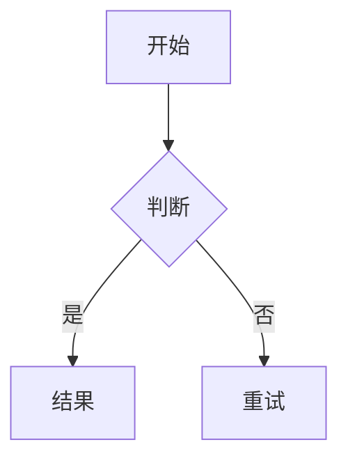

<!--
Markdown 渲染综合测试文档
目标：CommonMark + 常用扩展（GFM 及编辑器常见扩展）
用途：压测块解析、行内解析、嵌套、边界情况与混合模式渲染。
-->

# Markdown 渲染测试文档

> 本文档有意在同一个文件中混合大量 Markdown 语法。
> 用于测试解析器正确性、增量重渲染、光标行为、选区映射以及源码/渲染模式切换。

---

## 1. 段落、换行与空行

普通段落。

行尾两个空格强制硬换行。  
这是硬换行后的下一行。

软换行示例
下一行通常仍属于同一段落，除非渲染器在视觉上把它折叠。

用一个空行分隔的另一个段落。

### 标题之后的超短段落

---

## 2. 标题

# 一级标题 H1

## 二级标题 H2

### 三级标题 H3

#### 四级标题 H4

##### 五级标题 H5

###### 六级标题 H6

Setext 风格一级标题
==================

Setext 风格二级标题
------------------

标题中可包含 **加粗** 与 `代码`。

---

## 3. 强调、加粗、嵌套强调与边界情况

*斜体*

_斜体（下划线式）_

**加粗**

__加粗（下划线式）__

***加粗斜体***

___加粗斜体（下划线式）___

*斜体里放**加粗**文本*

这是 **包含 *斜体内嵌* 的加粗** 文本。

这是 *包含 ***加粗斜体*** 的斜体* 文本。

单词内部的下划线通常不触发强调：foo_bar_baz。

星号紧邻标点的情况：这*应该*被测试。

使用转义避免强调：\*不是斜体\* 与 \_不是斜体\_。

---

## 4. 行内代码与代码片段

`行内代码`

``包含 ` 反引号 ` 的行内代码``

```包含 `` 双反引号 `` 的行内代码```

行内代码可包含标点：`if (a < b && c > d) { return x; }`

行内代码中的强调符号按字面处理：`*不会变成斜体*`

行内代码中的链接按字面处理：`[文本](https://example.com)`

按分隔符规则保留首尾空格：`  首尾有空格  `

跨行的行内代码：
`第一行
第二行`

正文中的反引号：`` ` `` 以及 ``` `` ``` 以及 ```` ``` ````

---

## 5. 链接、图片、自动链接与引用式链接

[行内链接](https://example.com)

[带标题的行内链接](https://example.com "示例标题")

[含括号的链接](https://example.com/a_(b)c)

[引用式链接][ref-link]

[折叠引用][折叠引用]

[快捷引用][快捷引用]

[带尖括号的链接](<https://example.com/带空格 路径>)


![引用式图片][ref-image]

<https://example.com>

<mailto:test@example.com>

被转义的自动链接应保持字面：\\<https://example.com>

裸链接（GFM 自动链接扩展）：https://example.com

[ref-link]: https://example.com
[折叠引用]: https://example.org
[快捷引用]: https://example.net
[ref-image]: https://example.com/image.png "图片标题"

---

## 6. 列表

- 无序项 1
- 无序项 2
- 无序项 3

* 使用星号的无序项
* 另一项
* 又一项

+ 使用加号的无序项
+ 另一项

1. 有序项 1
2. 有序项 2
3. 有序项 3

1. 从指定数字开始
1. 后续项
1. 再一项

- 混合列表项
  - 嵌套无序
  - 带段落的嵌套项

    嵌套项内的续接段落。

- 带代码块的列表项
  ```
  let x = 1;
  let y = 2;
  ```

1. 带嵌套引用的有序项
   > 引用文本
   >
   > 引用第二段

- 带任务列表语法的项
  - [ ] 未勾选任务
  - [x] 已勾选任务

- 含强调与链接的项：**加粗** 与 [链接](https://example.com)

- 深层嵌套：
  1. 第一层有序
     - 第二层无序
       - 第三层无序
         1. 第四层有序

---

## 7. 引用块

> 引用段落一。
>
> 引用段落二，含 **加粗** 与 `代码`。

> 嵌套引用第一层
> > 嵌套引用第二层
> >
> > > 嵌套引用第三层

> 带列表的引用：
> - 项 1
> - 项 2
>   - 嵌套项

> 带代码块的引用：
>
> ```
> fn main() {
>     println!("hello");
> }
> ```

> 引用内可包含标题：
>
> #### 引用内标题

---

## 8. 代码块

缩进式代码块：

```
fn main() {
    println!("缩进式代码块");
}
```

带语言标注的围栏代码块：

```rust
fn main() {
    println!("围栏代码块");
}
```

带信息串与元数据的代码块：



围栏内包含反引号仍应正常：

```text
这一行包含 `反引号` 字面量。
```

用更长围栏包裹三个反引号：

~~~markdown
```
嵌套的围栏内容
```
~~~

更多语言覆盖：

```bash
echo "hello"
if [ -f ./file.txt ]; then
  echo ok
fi
```

```c
int add(int a, int b) {
    return a + b;
}
```

```cpp
class Box {
public:
    int value = 1;
};
```

```csharp
class App {
    static void Main() {
        var value = 42;
    }
}
```

```css
.card {
  color: #fff;
  display: grid;
}
```

```go
package main

func main() {
    println("hello")
}
```

```html
<div class="card">
  <span>Hello</span>
</div>
```

```java
class App {
    int add(int a, int b) {
        return a + b;
    }
}
```

```php
<?php
echo "hello";
$value = 42;
?>
```

```python
def double(x: int) -> int:
    return x * 2
```

```ruby
def hello(name)
  puts "Hello, #{name}"
end
```

```sql
SELECT id, name
FROM users
WHERE active = true
ORDER BY name;
```

```yaml
service:
  name: rumark
  enabled: true
```

```toml
[package]
name = "rumark"
edition = "2024"
```

```json
{
  "name": "rumark",
  "keywords": ["markdown", "编辑器"]
}
```

```jsx
const App = () => <button className="primary">OK</button>;
```

```tsx
type User = { id: number };
const App = (): JSX.Element => <div data-id={1}>TSX</div>;
```

无语言标注的围栏代码块：

```
没有语言标注，仅按纯文本渲染。
```

---

## 9. 分隔线

---

***

___

段落应当与分隔线上下保持为独立块。

## 文本

另一种类似段落的 Setext 情况。

---

## 10. HTML 块与行内 HTML

<div class="note">
  <p>HTML 块，包含 <strong>行内 HTML</strong>。</p>
</div>

<p>行内 HTML 段落，包含 <em>HTML 内的强调</em>。</p>

自定义元素测试：

<details>
<summary>可展开的摘要</summary>

隐藏内容，含 `行内代码` 与 **加粗**。

</details>

原始 HTML 注释不应可见渲染：

<!-- 这是一段注释 -->

表格类 HTML：

<table>
  <thead>
    <tr><th>列 A</th><th>列 B</th></tr>
  </thead>
  <tbody>
    <tr><td>1</td><td>2</td></tr>
  </tbody>
</table>

---

## 11. 转义与实体

\* 转义星号 \*

\_ 转义下划线 \_

\` 转义反引号 \`

\[ 转义方括号 \]

\# 转义标题符号

\> 转义引用符号

\- 转义列表符号

\. 转义有序列表点

\! 转义感叹号

\& 转义与号

实体：&copy; &amp; &lt; &gt; &quot; &nbsp; &hellip; &mdash;

AT&T 应保持可读。

十六进制与十进制实体：&#x2764; &#10084;

---

## 12. 表格

| 左对齐 | 居中 | 右对齐 |
| --- | :---: | ---: |
| a | b | c |
| **加粗** | `代码` | [链接](https://example.com) |
| 多行<br>HTML | 图片  | 文本 |

| 含竖线的单元格 | 转义竖线 |
| --- | --- |
| A \| B | 字面竖线 |

表格单元格内的行内格式：

| 语法 | 示例 |
| --- | --- |
| 斜体 | *斜体* |
| 加粗 | **加粗** |
| 代码 | `代码` |
| 链接 | [文本](https://example.com) |
| 删除线 | ~~删除线~~ |

无表头（若被支持）：

| 仅表头 |
| --- |
| 只有一行 |

---

## 13. 任务列表

- [ ] 未勾选任务
- [x] 已勾选任务
- [ ] 含 **加粗** 与 `代码` 的任务
- [x] 含 [链接](https://example.com) 的任务
- [ ] 含嵌套列表的任务
  - [ ] 嵌套未勾选
  - [x] 嵌套已勾选
- [X] 大写 X 的已完成任务

---

## 14. 脚注

这是一个脚注引用。[^1]

这是另一个脚注引用。[^longnote]

脚注可以出现在多个段落、列表与代码块之后。

[^1]: 脚注文本。

[^longnote]: 含 **加粗**、`代码` 与嵌套列表的脚注文本：

    - 项 1
    - 项 2

    脚注中的第二段。

---

## 15. 删除线

~~删除线~~

这是 ~~包含 ~~**~~加粗~~**~~ 与 `代码` 的删除文本~~。

多个波浪号未必在所有渲染器中都表示删除线：~~~三个波浪号~~~

---

## 16. 定义列表（扩展）

术语 1
: 定义 1

术语 2
: 含 **加粗** 与 `代码` 的定义 2。

另一个术语
: 第一段定义。

: 第二段定义。

---

## 17. 上标与下标（扩展）

x^2^

H\~2\~O

混排：E = mc^2^ 与 H\~2\~O 出现在同一段落。

---

## 18. Emoji 与提及（扩展）

:smile: :rocket: :warning: :thumbsup:

Unicode 表情：😀 🚀 ⚠️ 👍

@user-name

#123

---

## 19. 数学公式（扩展）

行内公式：$E = mc^2$

独立公式：

$$
\int_0^1 x^2 \, dx = \frac{1}{3}
$$

更复杂的公式：

$$
\begin{aligned}
a &= b + c \\
d &= a - b
\end{aligned}
$$

公式中包含类 Markdown 内容：
$ \\text{是否使用 *字面* Markdown？} $

---

## 20. 提示 / 警告块（扩展）

> [!NOTE]
> 这是一条注意提示。
>
> 可以包含 **加粗**、`代码` 与列表：
> - 项 1
> - 项 2

> [!WARNING]
> 这是一条带嵌套引用的警告提示：
>
> > 内层引用
>
> 以及一个围栏代码块：
>
> ```js
> console.log("warn");
> ```

> [!TIP]
> 这是一条技巧提示。

> [!IMPORTANT]
> 这是一条重要提示。

> [!CAUTION]
> 这是一条谨慎提示。

---

## 21. 混合组合压力测试

### 21.1 段落中的行内嵌套

段落含 **加粗、*斜体、`代码` 与 ***[***链接***](https://example.com)*** 位于斜体内部*** 之外。

段落含 `包含 [方括号] 与 *星号* 和 _下划线_ 的代码`，后面还有文本。

段落含一个标签内带强调的链接 [**加粗标签**](https://example.com)。

段落含图片与链接： 与 [另一个链接](https://example.org)。

### 21.2 块级嵌套

> 引用
>
> 1. 有序项
>   - 嵌套无序
>   - 含 **加粗** 的嵌套无序
>
> 1. 第二个有序项
>   ```python
>   print("位于引用与列表内部")
>   ```
>
>   代码块之后的段落。

### 21.3 列表嵌套引用与表格

- 列表项
  > 列表项内的引用
  >
  > | A | B |
  > | --- | --- |
  > | 1 | 2 |

- 含 HTML 块的列表项
  <div>
    <p>列表项内的 HTML</p>
  </div>

### 21.4 链接引用与强调冲突

这个 [引用][mix-ref] 即便被 **加粗** 包裹也应正确渲染。

这个 [快捷引用][shortcut] 也应正常工作。

[mix-ref]: https://example.com/mix
[shortcut]: https://example.com/shortcut

### 21.5 围栏 + 行内代码 + 强调冲突

```md
这个围栏块包含 `行内代码`、**加粗** 与 [链接](https://example.com)。
```

围栏之外：`行内代码` 与 **加粗** 与 [链接](https://example.com)。

---

## 22. 棘手边界情况

空行之后的空段落。


多个空行之后的段落。

以反斜杠硬换行的行。\
下一行。

以星号硬换行？这里在行尾放两个空格。  
下一行。

以标点开头的列表项：

- (可选) 项文本
- [ ] 标点之后的任务语法

含空行的引用块：

> 引用中的第一段。
>
> 引用中的第二段。

Setext 标题之后接段落

## 标题文本

Setext 标题之后的段落。

紧接段落之后的围栏代码块：

```json
{"key":"value"}
```

紧接段落之后的引用：

> 紧接段落之后的引用

紧接段落之后的分隔线：

## 段落

紧接段落之后的表格：

| A | B |
| --- | --- |
| 1 | 2 |

紧接段落之后的列表：

- 项 1
- 项 2

段落中的孤立标记符：* 单独星号、_ 单独下划线、~ 单独波浪号、` 单独反引号。

未闭合的强调：**这里是未闭合的加粗

未闭合的代码片段：`这里是未闭合的行内代码

---

## 23. 原始源码诊断辅助

<!--
使用本节检查编辑器是否保留源码范围与语法高亮状态。
可自行保留或删除。
-->

源码范围探针：`alpha` `beta` `gamma`

分隔符密度探针：`a` `b` `c`

空白探针：`  左  ` 与 `右` 与 ` 中 `。

混合标点探针：([*链接*](https://example.com)) 与 

光标定位探针：在 `代码`、**加粗**、*斜体* 之间移动光标。

---

## 24. 最终混合大块

> [!IMPORTANT]
> 最终混合块，组合了：
>
> - **加粗**
> - *斜体*
> - `行内代码`
> - [链接](https://example.com)
> - 
> - ~~删除线~~
>
> 以及一个表格：
>
> | 键 | 值 |
> | --- | --- |
> | a | 1 |
> | b | 2 |
>
> 以及一个围栏代码块：
>
> ```ts
> export const answer = 42;
> ```
>
> 以及一个脚注引用。[^final]
>
> [^final]: 最终脚注文本，含嵌套列表：
>
>     - 一
>     - 二

---

测试文档结束。
